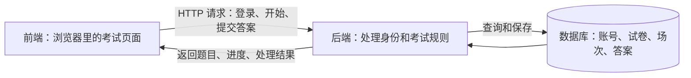

# 梳理考试系统代码与任务边界

> 我现在需要根据readme在理解现有工程的基础上完成后端和数据库建设，使系统能够运行。但是作为一个考试系统我还是区分不清前后端，你帮我梳理一下已有代码究竟做了什么，我的任务范围边界又是什么

<details><summary>4 previous messages</summary>

> 我先看 README、目录结构和主要代码，确认考试流程里哪些已经实现、哪些还是模拟数据，再据此梳理前后端分工和你要补齐的后端、数据库范围。
>
> <details><summary>Ran 7 commands</summary>
>
> - Ran `Get-Location; rg --files -g 'AGENTS.md' -g '*README*' -g '*readme*' -g 'package.json' -g 'pom.xml' -g 'build.gradle*' -g 'requirements*.txt' -g 'pyproject.toml' -g 'docker-compose*' -g '*.sln' -g '*.csproj' -g '!node_modules' -g '!.git'`
> - Ran `rg --files -g '!node_modules' -g '!.git' -g '!package-lock.json' -g '!pnpm-lock.yaml' -g '!yarn.lock'; rg --files --hidden -g AGENTS.md -g '!node_modules' -g '!.git' D:\Blue`
> - Ran `Get-ChildItem -Force; Get-Content -Raw README.md; Get-Content -Raw package.json`
> - Ran `Get-Content -Raw '笔试题说明.md'; Get-Content -Raw src/api/examApi.ts; Get-Content -Raw src/constants/apiPaths.ts`
> - Ran `Get-Content -Raw src/services/AuthService.ts; Get-Content -Raw src/services/TokenRefreshService.ts; Get-Content -Raw src/utils/ApiUtils.ts; Get-Content -Raw src/contexts/AuthContext.tsx; Get-Content -Raw src/config/env.ts; Get-Content -Raw .env.example; Get-Content -Raw vite.config.ts; Get-Content -Raw nginx.conf`
> - Ran `Get-Content -Raw src/pages/GuestExamPage.tsx; Get-Content -Raw src/hooks/useQuestionCountdown.ts; Get-Content -Raw src/utils/guestQuota.ts; Get-Content -Raw src/utils/LocalStorageUtil.ts`
> - Ran `Get-Content -Raw src/components/guest/GuestTestScreen.tsx; Get-Content -Raw src/components/guest/GuestWelcomeScreen.tsx; Get-Content -Raw src/components/guest/GuestCompletionScreen.tsx; Get-Content -Raw src/pages/LoginPage.tsx; Get-Content -Raw src/App.tsx; Get-Content -Raw src/components/ProtectedRoute.tsx`
>
> </details>
>
> 已经确认：仓库提供的是考生端前端，没有后端、数据库或本地模拟题库。README 提到的 `task4 / BlueCommonService` 是原工程依赖的服务；结合笔试说明，你需要自行实现兼容接口，并不要求复原整个原系统。
>
> 接下来我重点核对倒计时、续考和交卷，因为这些虽然已有页面交互，仍需要后端保存状态并执行规则。
>
> <details><summary>Ran 2 commands</summary>
>
> - Ran `rg -n 'interface|function|const PREFIX|LOGIN:|REGISTER:|REFRESH:|LOGOUT:|ME:|getAvailableExams:|startExam:|submitAnswer:|getExamProgress:|resumeExam:|finishExam:|getMyExamRecords:' src/api/examApi.ts src/constants/apiPaths.ts; rg -n 'phase|setExistingSessionCode|setPhase|res.code === 200 && res.data|latestAnswerRef|remainingSeconds|questionIndex|Promise.all' src/pages/GuestExamPage.tsx; rg -n '独立前端|BlueCommonService|Docker|基本题|加分题|不要求|交付|恢复|重启|评分' README.md 笔试题说明.md; git status --short`
> - Ran `Get-Content src/components/guest/GuestTestScreen.tsx -TotalCount 145; Get-Content -Raw src/components/guest/GuestCompletionScreen.tsx; Get-Content -Raw src/utils/examHtml.ts; Get-Content -Raw src/components/exam/SafeHtmlContent.tsx; rg -n '60|秒|分钟|限|作答|返回|题|logout|退出|resume|评分' src/components/guest/GuestWelcomeScreen.tsx src/components/guest/GuestTestScreen.tsx src/components/guest/GuestCompletionScreen.tsx src/components/guest/GuestProgressHeader.tsx`
>
> </details>
</details>

我读了 README、笔试说明，以及登录、答题、倒计时和接口相关代码。**目前工程已经做了“考生在浏览器里如何操作”的前端，但没有实现“服务器如何处理考试、数据库如何保存结果”。你的主要任务，就是补齐后面两部分，并完成必要的前端对接。**

具体任务范围要以 [笔试题说明.md](./intern-written-test/笔试题说明.md:13) 为准；README 中提到的 `task4 / BlueCommonService` 是原工程依赖的后端，本仓库没有提供它的实现。

下面结合这个项目解释。

**前端、后端和数据库，分别负责什么**

判断一段代码属于前端还是后端，主要看它在哪里运行、承担什么责任。这个项目中的 React、TypeScript 代码主要在浏览器运行，因此即使文件名叫 `AuthService`、`examApi`，也仍然属于前端。



| 以“提交一道题”为例 | 负责的事情 |
|---|---|
| 前端 | 显示选项、记录本次选择；点击“下一题”后发送答案；收到响应后显示下一题 |
| 后端 | 确认是谁提交、场次是否属于他、是否已经交卷、提交的是否为当前题；保存答案并决定下一题 |
| 数据库 | 长期保存这次场次、作答记录和当前进度，关闭页面或重启服务后仍存在 |

**因此，“页面上能够选择答案”，和“系统已经可靠保存答案”，是两件需要分别实现的事情。**

**已有代码究竟做了什么**

| 模块 | 已有实现 | 仍然依赖后端的部分 |
|---|---|---|
| 登录、注册页面 | 手机号和密码输入、表单检查、错误提示、成功后跳转 | 创建账号、检查密码、建立登录会话 |
| 登录状态和路由 | 缓存用户信息；页面层面阻止未登录访问 | 校验真实身份、会话过期和刷新 |
| 考试欢迎页 | 展示说明、开始或继续考试按钮、退出登录 | 查询可用试卷、查找用户已有考试 |
| 答题页面 | 展示材料、题干、图片、单选和多选；整理答案格式 | 提供真实题目、校验并保存答案 |
| 倒计时 | 显示剩余秒数、临近超时提醒、到零自动提交 | 保存计时依据，刷新后返回真实剩余时间 |
| 续考 | 请求恢复接口，并显示后端返回的当前题 | 从数据库恢复场次、进度和剩余时间 |
| 交卷和完成页 | 提前交卷确认；显示“提交成功” | 将考试标记为结束，并禁止继续修改答案 |

几个关键文件可以按这个顺序阅读：

- [App.tsx](./intern-written-test/src/App.tsx)：页面入口，主要是 `/login` 和 `/exam`。
- [GuestExamPage.tsx](./intern-written-test/src/pages/GuestExamPage.tsx)：考试流程的核心，控制“欢迎 → 答题 → 完成”。
- [GuestTestScreen.tsx](./intern-written-test/src/components/guest/GuestTestScreen.tsx)：选择答案、下一题、提前交卷等界面交互。
- [examApi.ts](./intern-written-test/src/api/examApi.ts)：前端准备怎样调用考试接口。
- [AuthService.ts](./intern-written-test/src/services/AuthService.ts)：前端怎样调用登录、注册等接口。

这里最容易混淆的是：`examApi.ts` 中的 `startExam()` **只是发送一个“开始考试”的请求**，它没有创建数据库场次，也没有生成题目。这些需要你在后端实现。

另外，Vite 虽然会启动一个开发服务器，但这里它主要负责提供前端页面和转发 API 请求，不负责考试业务。默认前端是 `5173` 端口，API 转发目标是 `8003`。

**已有前端规定了怎样的考试流程**

从 [GuestExamPage.tsx](./intern-written-test/src/pages/GuestExamPage.tsx:76) 可以梳理出：

1. 进入欢迎页，同时请求“可用试卷”和“我的考试记录”。
2. 没有已有记录时，点击开始，调用 `startExam`。
3. 有已有记录时，点击继续，调用 `resumeExam`。
4. 后端返回场次编号 `sessionCode` 和当前题。
5. 用户提交答案，后端返回下一题，或者告诉前端考试已经结束。
6. 用户也可以调用 `finishExam` 提前交卷。

这套交互是**逐题向前作答**。现有页面没有回到上一题修改答案的功能，你不需要自行扩展成完整的答题卡系统。

单选答案发送为 `"A"`，多选为排序后的 `"A,C"`；超时且没有选择时发送空字符串。当前页面用 `questionType === 1` 表示多选，其余按单选展示，后端需要和这个约定一致。

**你的后端需要接住哪些接口**

接口路径集中在 [apiPaths.ts](./intern-written-test/src/constants/apiPaths.ts)。统一前缀是：

`/api/blue/bluecommonservice`

| 方法 | 前缀之后的路径 | 你需要实现的职责 |
|---|---|---|
| POST | `/auth/register` | 注册账号；按现有约定同时建立登录会话 |
| POST | `/auth/login` | 校验手机号和密码，建立会话 |
| POST | `/auth/logout` | 使会话失效并清理 Cookie |
| GET | `/auth/me` | 根据会话返回当前用户 |
| POST | `/auth/refresh` | 刷新登录会话 |
| POST | `/exam/getAvailableExams` | 返回可以参加的试卷 |
| POST | `/exam/startExam` | 创建或按约定复用考试场次，返回当前题 |
| POST | `/exam/getMyExamRecords` | 返回当前用户的考试记录 |
| POST | `/exam/resumeExam` | 恢复指定场次 |
| GET | `/exam/getExamProgress` | 返回考试进度 |
| POST | `/exam/submitAnswer` | 保存本题答案，推进到下一题或结束 |
| POST | `/exam/finishExam` | 提前交卷并结束场次 |

现有请求代码默认携带 Cookie，响应通常需要这个结构：

```json
{
  "code": 200,
  "message": "成功",
  "data": {}
}
```

优先兼容这些约定，可以减少前端修改。**路径里叫 `bluecommonservice`，不意味着你必须采用微服务架构。** 一个后端应用就可以实现这些接口；语言、框架和数据库由你选择。

**数据库需要保存什么**

题目没有指定表结构。下面是一个便于理解的起点，实际可以合理合并或拆分：

| 数据实体 | 主要内容 |
|---|---|
| 用户 | 用户 ID、唯一手机号、密码的安全哈希、创建时间 |
| 登录会话 | 对应用户、会话凭据、过期或失效状态 |
| 试卷 | 试卷 ID、名称、可用状态 |
| 题目 | 题干、材料、类型、选项、单题时限；如实现评分，再保存标准答案等 |
| 试卷题目关系 | 哪套试卷包含哪些题，以及题目顺序 |
| 考试场次 | `sessionCode`、用户、试卷、当前题、进行中或已结束状态、计时信息 |
| 作答记录 | 所属场次、题目、提交答案、提交时间等 |

其中最重要的是分清：

- **试卷**：一套考试内容。
- **场次**：某个用户参加这套试卷的一次过程。

两个用户可以使用同一套试卷，但必须拥有各自的场次和作答记录。后端每次处理场次请求，都要检查它是否属于当前登录用户；不能仅凭前端传来的 `sessionCode` 就允许读写。

**你的任务边界，可以分成三类**

| 必须完成 | 允许按需调整 | 当前不要求建设 |
|---|---|---|
| 任意新用户自行注册、登录、退出 | 前端接口字段和错误处理 | 管理员后台、在线题库编辑器 |
| 至少一套含单选、多选的示例试卷 | 续考和完成状态的展示 | AI 面试、录音录像 |
| 开始、作答、下一题、超时、续考、正常及提前交卷 | 与示例试卷不符的页面说明 | 招聘门户、报表导出 |
| 数据持久化、用户隔离、交卷后禁止修改 | 会话机制，但要同步适配并解释 | 短信服务、找回密码等扩展 |
| 初始化脚本、部署和验收材料 | 必要的界面对接修复 | 购买云服务或部署到公网 |

另外，**名为“加分题”的部分实际要求二选一完成**：自动化测试，或者防作弊工具，并不是可以完全不做。

README 提到了评分，但笔试基本题没有明确要求复杂评分算法或成绩展示。可以实现简单客观题评分；不需要因此扩展出完整的成绩管理系统。

**对接时，已有前端还有几个需要处理的边界**

这些是我根据代码发现的具体情况：

1. **“续考”目前没有区分进行中和已完成记录。**
   页面直接取“我的考试记录”第一条作为续考目标。因此需要补充状态判断，避免把已交卷场次当成未完成考试。

2. **刷新后，当前题尚未提交的选择不会保留。**
   选项目前只存在 React 内存里，没有草稿保存接口。必须恢复的是已保存的进度；是否额外恢复未提交选择，需要明确设计，不能认为现成代码已经支持。

3. **浏览器倒计时不能代替后端计时规则。**
   前端按后端返回的秒数显示倒计时，但后端仍需记录时间依据。否则用户刷新页面可能重新获得完整时长。超时提交、重复请求和断网重试的处理规则也需要明确。

4. **交卷响应要与页面判断兼容。**
   当前提前交卷代码同时检查 `code === 200` 和 `data` 是否存在。后端如果只返回成功码，没有有效的 `data`，页面仍会提示交卷失败。

5. **欢迎页中的“约 30 题、30 分钟”是固定文案。**
   笔试允许题量自定，不必为了这段文字准备 30 道题；可以修改文案。单题“1 分钟”的说明也应和实际配置一致。

最后，判断任务完成与否，应直接对照验收流程：**两个新用户可以独立注册、登录、作答；刷新能续考；正常和提前交卷后不能再改答案；重启服务后数据仍在；评审能按文档自行启动并复现。**

交付还需要包含所选加分题、设计与部署说明、实际验证结果，以及完整 AI 对话记录。以上是对现有代码的静态梳理，本轮没有修改工程，也没有运行验证。

> 我看到很多ts和tsx文件，它们是什么代码，我需要了解吗

需要了解，但**不必先学会整个前端技术栈，也不用逐个读完所有文件**。你当前最需要读懂的是：页面什么时候请求后端、发送什么数据、期待什么结果。

`.ts` 和 `.tsx` 都是 **TypeScript 代码**。TypeScript 在 JavaScript 基础上增加了类型描述，帮助开发者提前发现数据使用错误。它们在这个工程里主要属于前端。

| 文件后缀 | 通常写什么 | 本工程中的例子 |
|---|---|---|
| `.ts` | 数据类型、接口调用、工具函数等 | `examApi.ts` 定义怎样请求考试接口 |
| `.tsx` | 可以包含 JSX 界面语法，常用于 React 页面和组件 | `GuestTestScreen.tsx` 描述答题页面 |

例如，`.ts` 里可能写：

```ts
interface LoginRequest {
  phone: string
  password: string
}
```

意思是：登录请求需要手机号和密码，两个字段都是字符串。**这只是描述数据格式，没有实现注册或密码校验。**

`.tsx` 里可能写：

```tsx
<Button onClick={handleStart}>
  开始考试
</Button>
```

意思是：显示一个“开始考试”按钮，用户点击后执行 `handleStart`。你可以把它理解成“界面和操作行为写在一起”。

对你这次任务，建议按下面的深度阅读：

| 文件 | 你需要理解什么 | 优先级 |
|---|---|---|
| [apiPaths.ts](./intern-written-test/src/constants/apiPaths.ts) | 前端请求哪些接口地址 | 必看 |
| [examApi.ts](./intern-written-test/src/api/examApi.ts) | 考试接口的请求参数和返回字段 | 必看 |
| [AuthService.ts](./intern-written-test/src/services/AuthService.ts) | 登录注册的数据格式、Cookie 会话约定 | 必看 |
| [GuestExamPage.tsx](./intern-written-test/src/pages/GuestExamPage.tsx) | 开始、续考、答题、交卷的调用顺序 | 重点看流程 |
| [ApiUtils.ts](./intern-written-test/src/utils/ApiUtils.ts) | 请求怎么发出、成功和错误怎么处理 | 重点看约定 |
| 其他页面、组件和样式文件 | 按钮、布局、颜色、动画等 | 改界面或排查问题时再看 |

读代码时，可以先抓住几个常见词：

- `interface`：数据格式说明。
- `import`：从其他文件引入代码。
- `async / await`：等待网络请求等异步操作完成。
- `useState`：保存页面当前状态，例如当前题目。
- `useEffect`：在页面加载或状态变化后执行操作，例如查询考试记录。
- `onClick / onSubmit`：点击或提交时触发的处理函数。

**你现阶段的阅读目标是能讲清楚：“点击这个按钮 → 调用哪个接口 → 传什么 → 后端返回什么 → 页面如何变化。”** 能做到这一点，就足以开始设计后端和数据库；复杂的页面布局、动画和 React 写法可以按需再学。

> 那整个项目我如何测试呢

整个项目要分成 **前端检查、后端接口测试、浏览器完整流程测试** 三层。目前仓库只有前端，可以先检查页面和构建；注册、考试等完整业务，要等后端和数据库补齐后才能验证。

你可以把下面这套顺序作为开发期间的测试流程。

**1. 先确认现有前端能启动**

在 PowerShell 中执行：

```powershell
cd D:\Blue\intern-written-test
npm ci
Copy-Item .env.example .env.local
npm run lint
npm run build
npm run dev
```

如果 `.env.local` 已经存在，保留已有配置。

这些命令分别检查：

| 命令 | 能验证什么 |
|---|---|
| `npm ci` | 依赖能否按锁定版本安装 |
| `npm run lint` | 是否存在代码规范或部分潜在问题 |
| `npm run build` | TypeScript 检查和前端打包能否通过 |
| `npm run dev` | 启动页面，供浏览器实际操作 |

打开 [本地前端](http://localhost:5173)。

**构建通过只表示前端可以打包，不代表考试业务正常。** 当前没有后端，登录、注册等请求失败是预期情况。

现有 `package.json` 也没有 `npm test`，自动化测试需要后续新增。

**2. 每实现一个后端接口，就单独测试它**

接口测试是绕过页面，直接向后端发送请求，检查响应和数据库。

以注册为例，要同时检查：

- 输入新手机号和密码，是否注册成功。
- 数据库是否新增用户，密码是否安全存储。
- 重复注册是否被拒绝。
- 响应是否符合前端需要的格式。
- 是否建立 Cookie 会话，后续 `/auth/me` 能否识别用户。

考试接口也是一样。提交答案后，不只看“返回成功”，还要查询数据库，确认答案确实保存、进度确实推进。

这样可以分清：**是后端本身有问题，还是前端与后端没有对接好。**

**3. 后端接通后，用浏览器走完整考试**

开发环境默认将前端 API 请求转发到 `http://localhost:8003`。后端需要监听这个地址，或者修改 `.env.local` 的 `VITE_API_PROXY_TARGET`，然后重启前端开发服务。

建议准备两个新账号，按照这张清单验收：

| 测试场景 | 操作 | 应有结果 |
|---|---|---|
| 新用户注册 | 用从未注册的手机号注册 | 成功进入系统，无须手动创建账号 |
| 重复注册 | 再次注册同一手机号 | 明确报错，不产生重复用户 |
| 登录校验 | 分别输入正确和错误密码 | 正确密码成功，错误密码失败 |
| 退出登录 | 退出后再次访问考试接口 | 后端拒绝访问 |
| 单选、多选 | 分别选择并提交答案 | 保存正确的选项，进入下一题 |
| 超时 | 等待当前题倒计时结束 | 自动提交并推进，未选择时也能处理 |
| 续考 | 提交几题后刷新页面，再继续 | 恢复已保存进度，剩余时间符合规则 |
| 提前交卷 | 考到中途点击交卷 | 场次结束，页面显示完成 |
| 正常完成 | 做完最后一题 | 场次结束，页面显示完成 |
| 结束后修改 | 对已结束场次再次提交答案 | 后端拒绝修改 |
| 用户隔离 | 两个账号分别考试 | 进度和答案互不覆盖 |
| 越权访问 | 用账号 B 请求账号 A 的场次 | 后端拒绝读取或修改 |
| 服务重启 | 保存进度后重启后端 | 账号和考试数据仍在，能继续使用 |
| 重复提交 | 对同一题重复发送提交请求 | 不产生重复记录，不多跳一道题 |

测试两个用户时，使用**两个独立浏览器配置或两个不同浏览器**。同一浏览器的普通标签页通常共享 Cookie，不能当成两个独立用户。

**4. 出问题时，用浏览器的 Network 面板定位**

按 `F12`，打开 **Network（网络）**，然后操作页面：

```text
点击按钮
  ↓
有没有发请求？
  ↓
请求地址、参数是否正确？
  ↓
后端返回了什么？
  ↓
数据库是否发生了预期变化？
  ↓
页面是否正确显示结果？
```

例如，“点击下一题没有变化”可能来自不同位置：

| 看到的现象 | 优先检查 |
|---|---|
| 没有请求 | 前端按钮事件、表单校验 |
| 请求失败或连接被拒绝 | 后端是否启动、代理地址 |
| 返回 401 | Cookie、登录会话 |
| 返回成功但页面不切题 | 返回字段是否符合前端约定，例如 `nextQuestion` |
| 页面切题但数据库没记录 | 后端保存逻辑或事务 |
| 刷新后进度丢失 | 数据持久化和续考接口 |

**5. 最后补自动化测试和真实记录**

如果选择“AI 辅助测试策略与自动化测试”这道加分题，需要把一条完整的“注册 → 登录 → 开始考试 → 答题 → 交卷”流程写成可执行测试，再覆盖错误密码、未登录、跨用户访问、重复提交、续考等关键情况。

保存测试命令、运行结果、发现的问题及修复记录。交付前还要按照部署说明，从一个空数据库重新初始化并运行一遍，确认评审能够复现。

你当前可以先完成第 1 步；之后每补一个后端功能，就做接口测试和对应的页面测试，不必等全部写完才开始。

> 那后端操作时使用python还是java呢

<details><summary>2 previous messages</summary>

> 这份笔试允许自行选择后端语言。我结合你目前需要补齐的功能，比较一下 Python 和 Java 的实现成本，再给你一个具体建议。
>
> <details><summary>Searched the web</summary>
>
> Searched the web for `site.fastapi.tiangolo.com features automatic docs validation SQL databases SQLite ...`
>
> </details>
</details>

**两种都可以。如果你没有明显更熟悉 Java，我建议这次用 Python。** 笔试明确允许自由选择后端语言，现有前端也不限制后端必须用什么语言。

前端通过 HTTP 请求与后端交换 JSON 数据，因此可以这样组合：

```text
现有 React / TypeScript 前端
            ↓ HTTP 请求
你编写的 Python 或 Java 后端
            ↓
          数据库
```

前端不需要因为后端用了 Python 就重新编写。

| 对比 | Python | Java |
|---|---|---|
| 常用后端框架 | FastAPI | Spring Boot |
| 对初学者的实现成本 | 通常代码较少，便于逐个理解接口 | 通常需要同时理解更多工程概念 |
| 完成本题所需功能 | 可以全部完成 | 可以全部完成 |
| 适合你的情况 | 已会一些 Python，希望尽快完成并理解系统 | 已学过 Java，或岗位明确重视 Java 技术栈 |

Java 的 Spring Boot 同样适合实现接口和数据库访问，官方提供了相应的 [REST 接口教程](https://spring.io/guides/gs/rest-service/) 和 [数据库访问教程](https://spring.io/guides/gs/accessing-data-jpa/)。选择 Python 是我对这次学习与交付成本的判断，不是考试系统只能用 Python。

我建议的起步方案是：

| 部分 | 选择 | 用途 |
|---|---|---|
| 前端 | 保留现有工程 | 登录和考试页面 |
| 后端 | Python + FastAPI | 实现登录、题目、答题、续考和交卷接口 |
| 数据库 | SQLite 文件数据库 | 保存用户、试卷、场次、作答记录 |

FastAPI 提供请求参数校验和自动生成的交互式接口文档，方便你在前端接通之前单独测试接口；官方也有 SQLite 数据库示例。[FastAPI 功能说明](https://fastapi.tiangolo.com/features/)、[数据库教程](https://fastapi.tiangolo.com/tutorial/sql-databases/)

对于这次本地部署、少量用户验收的笔试，我认为这个组合比较合适。SQLite 需要使用**持久化文件**，不能使用服务停止就消失的内存数据库。

你真正需要投入精力的是：**身份校验、数据关系、用户隔离、倒计时恢复、重复提交和交卷后禁止修改**。这些规则使用 Python 或 Java 都要认真实现。

如果你已经学过 Java、对 Python 几乎不了解，就优先用 Java；否则，我建议以 **Python + FastAPI + SQLite** 开始。

> 这个手机号必须是真实的吗，开发和测试时可以使用虚拟的吗

<details><summary>2 previous messages</summary>

> 我看一下现有页面对手机号的校验规则，确认测试号码需要满足什么格式。
>
> <details><summary>Ran a command</summary>
>
> - Ran `rg -n 'PHONE_REGEX|pattern:|验证码|短信|phone' src/pages/LoginPage.tsx src/services/AuthService.ts 笔试题说明.md`
>
> </details>
</details>

**可以使用自定义的测试号码，不需要能接收短信的真实手机号。**

这份笔试要求的是“手机号 + 密码”注册登录，没有要求短信验证码或验证号码归属。

当前前端只检查号码格式，规则在 [LoginPage.tsx](./intern-written-test/src/pages/LoginPage.tsx:17)：

```ts
/^1[3-9]\d{9}$/
```

即：共 11 位数字，第一位是 `1`，第二位是 `3～9`。**格式通过不代表号码真实存在。**

开发时可以准备两个符合格式的测试账号，分别验证用户隔离。后端需要做到：

- 注册时校验格式，并保证手机号唯一。
- 登录时检查账号是否存在、密码是否正确。
- 测试账号也正常写入数据库，走完整注册登录流程，不能写死为“直接登录成功”。

这些测试号码可能恰好属于现实用户，因此仅作为本地测试数据，不要向其发送短信或拨打电话。交付时说明“未接入短信验证，手机号作为账号标识”即可。

> 那你用Python + FastAPI + SQLite逐一实现你之前提到的后端测试场景，自行操作不用一直问我，不过请用git管理好版本防止意外，并且工作区以外文件严禁修改

<details><summary>24 previous messages</summary>

> 我会在当前工作区内实现后端、数据库和自动化测试，并用 Git 分阶段保存。先检查仓库状态和本地环境，再补齐注册登录、考试与续考流程，最后逐项验证前面列出的测试场景；不会修改工作区以外的文件。
>
> <details><summary>Ran 5 commands, searched the web</summary>
>
> - Ran `git -c core.fsmonitor=false status --short; git -c core.fsmonitor=false log -3 --oneline; Get-ChildItem -Force; rg --files --hidden -g AGENTS.md -g '!node_modules' -g '!.git' D:\Blue`
>
> - Ran `python --version; py --version; node --version; npm --version; Get-Content -Raw .gitignore; Get-Content -Raw src/pages/GuestExamPage.tsx; Get-Content -Raw src/services/AuthService.ts; Get-Content -Raw src/utils/ApiUtils.ts`
>
> - Ran `Get-Item 'C:\Users\32533\.cache\codex-runtimes\codex-primary-runtime\dependencies\python\python.exe'; & 'C:\Users\32533\.cache\codex-runtimes\codex-primary-runtime\dependencies\python\python.exe' -B -c "import sys, importlib.util; print(sys.version); print({m: bool(importlib.util.find_spec(m)) for m in ['fastapi','uvicorn','httpx','pytest','playwright']})"; git -c core.fsmonitor=false branch --show-current; git config user.name; git config user.email; Get-Content -Raw src/contexts/AuthContext.tsx; Get-Content -Raw src/api/examApi.ts; Get-Content -Raw src/hooks/useQuestionCountdown.ts; Get-Content -Raw src/services/TokenRefreshService.ts`
>
> - Ran `git -c core.fsmonitor=false switch -c feature/python-backend-tests; New-Item -ItemType Directory -Force .runtime/tmp | Out-Null; $env:TEMP = Join-Path (Get-Location) '.runtime\tmp'; $env:TMP = $env:TEMP; $env:PYTHONDONTWRITEBYTECODE = '1'; & 'C:\Users\32533\.cache\codex-runtimes\codex-primary-runtime\dependencies\python\python.exe' -B -m venv .venv; .\.venv\Scripts\python.exe -B -m pip --version`
>
> Searched the web for `site.fastapi.tiangolo.com advanced response-cookies testing lifespan testclient ...`
>
> - Ran `$env:TEMP = Join-Path (Get-Location) '.runtime\tmp'; $env:TMP = $env:TEMP; $env:PIP_CACHE_DIR = Join-Path (Get-Location) '.runtime\pip-cache'; $env:PYTHONDONTWRITEBYTECODE = '1'; .\.venv\Scripts\python.exe -B -m pip install --disable-pip-version-check --no-cache-dir fastapi uvicorn httpx pytest`
>
> </details>
>
> Git 工作分支 `feature/python-backend-tests` 已建立，原仓库没有未提交改动。Python 虚拟环境也已建在项目内；依赖下载遇到网络沙箱限制，正在通过自动审批重试。实现将沿用现有接口和 Cookie 会话，并明确处理超时、重复提交和已交卷场次。
>
> <details><summary>Created 15 files, edited a file, ran 2 commands</summary>
>
> - Ran `$env:TEMP = Join-Path (Get-Location) '.runtime\tmp'; $env:TMP = $env:TEMP; $env:PIP_CACHE_DIR = Join-Path (Get-Location) '.runtime\pip-cache'; $env:PYTHONDONTWRITEBYTECODE = '1'; .\.venv\Scripts\python.exe -B -m pip install --disable-pip-version-check --no-cache-dir fastapi uvicorn httpx pytest`
> - Wrote `./intern-written-test/.gitignore` (+11 -0)
> - Wrote `./intern-written-test/backend/__init__.py` (+1 -0)
> - Wrote `./intern-written-test/backend/config.py` (+26 -0)
> - Wrote `./intern-written-test/backend/db.py` (+61 -0)
> - Wrote `./intern-written-test/backend/migrations/001_initial.sql` (+71 -0)
> - Wrote `./intern-written-test/backend/schemas.py` (+30 -0)
> - Wrote `./intern-written-test/backend/security.py` (+28 -0)
> - Wrote `./intern-written-test/backend/seed.json` (+12 -0)
> - Wrote `./intern-written-test/backend/.env.example` (+6 -0)
> - Wrote `./intern-written-test/backend/exams.py` (+130 -0)
> - Wrote `./intern-written-test/backend/main.py` (+202 -0)
> - Wrote `./intern-written-test/pytest.ini` (+3 -0)
> - Ran `$env:npm_config_cache = Join-Path (Get-Location) '.runtime\npm-cache'; $env:TEMP = Join-Path (Get-Location) '.runtime\tmp'; $env:TMP = $env:TEMP; npm install --save-dev @playwright/test`
> - Wrote `./intern-written-test/backend/tests/__init__.py` (+0 -0)
> - Wrote `./intern-written-test/backend/tests/conftest.py` (+60 -0)
> - Wrote `./intern-written-test/backend/tests/test_auth.py` (+96 -0)
> - Wrote `./intern-written-test/backend/tests/test_exams.py` (+176 -0)
>
> </details>
>
> 后端主体和第一批测试已写好：包含六题示例卷、数据库迁移、密码哈希、Cookie 会话、场次快照和用户权限检查。超时规则已明确为：服务端截止后记作空答案；重复提交不会多跳一题；已交卷场次禁止修改。现在开始实际运行测试，再修正前端的续考和完成状态对接。
>
> <details><summary>Created 4 files, edited 8 files, ran 7 commands</summary>
>
> - Ran `$env:npm_config_cache = Join-Path (Get-Location) '.runtime\npm-cache'; $env:TEMP = Join-Path (Get-Location) '.runtime\tmp'; $env:TMP = $env:TEMP; npm install --save-dev @playwright/test`
> - Ran `Get-Content -Raw src/contexts/authState.ts; Get-Content -Raw src/components/guest/GuestWelcomeScreen.tsx; Get-Content -Raw src/pages/LoginPage.tsx | Select-Object -First 1; Get-Content eslint.config.js; Get-Content tsconfig.json`
> - Ran `$env:TEMP = Join-Path (Get-Location) '.runtime\tmp'; $env:TMP = $env:TEMP; $env:PYTHONDONTWRITEBYTECODE = '1'; .\.venv\Scripts\python.exe -B -m pip freeze | Set-Content -Encoding utf8 backend/requirements.lock.txt; .\.venv\Scripts\python.exe -B -m pytest --basetemp=.runtime/pytest --junitxml=.runtime/backend-results.xml`
> - Wrote `./intern-written-test/src/api/examApi.ts` (+3 -1)
> - Wrote `./intern-written-test/src/components/guest/GuestTestScreen.tsx` (+1 -2)
> - Wrote `./intern-written-test/src/components/guest/GuestWelcomeScreen.tsx` (+5 -5)
> - Wrote `./intern-written-test/src/contexts/AuthContext.tsx` (+7 -7)
> - Wrote `./intern-written-test/src/pages/GuestExamPage.tsx` (+41 -15)
> - Wrote `./intern-written-test/src/pages/LoginPage.tsx` (+4 -1)
> - Ran `git -c core.fsmonitor=false status --short; Get-Content -Raw backend/requirements.lock.txt; Get-Item 'C:\Program Files (x86)\Microsoft\Edge\Application\msedge.exe' -ErrorAction SilentlyContinue; Get-Item 'C:\Program Files\Google\Chrome\Application\chrome.exe' -ErrorAction SilentlyContinue`
> - Ran `$env:PYTHONDONTWRITEBYTECODE = '1'; $env:TEMP = Join-Path (Get-Location) '.runtime\tmp'; $env:TMP = $env:TEMP; .\.venv\Scripts\python.exe -B -m pytest backend/tests/test_auth.py::test_registration_login_wrong_password_logout -vv -s -o faulthandler_timeout=15 --basetemp=.runtime/pytest-debug`
> - Ran `$env:TEMP = Join-Path (Get-Location) '.runtime\tmp'; $env:TMP = $env:TEMP; $env:PYTHONDONTWRITEBYTECODE = '1'; .\.venv\Scripts\python.exe -B -m pytest --basetemp=.runtime/pytest-run --junitxml=.runtime/backend-results.xml -o faulthandler_timeout=30`
> - Ran `$env:PLAYWRIGHT_BROWSERS_PATH = Join-Path (Get-Location) '.runtime\browsers'; $env:PLAYWRIGHT_SKIP_BROWSER_GC = '1'; $env:TEMP = Join-Path (Get-Location) '.runtime\tmp'; $env:TMP = $env:TEMP; node node_modules/@playwright/test/cli.js install chromium --only-shell`
> - Wrote `./intern-written-test/playwright.config.ts` (+36 -0)
> - Wrote `./intern-written-test/scripts/backend.mjs` (+26 -0)
> - Wrote `./intern-written-test/scripts/e2e.mjs` (+24 -0)
> - Wrote `./intern-written-test/tests/e2e/exam.spec.ts` (+124 -0)
> - Wrote `./intern-written-test/eslint.config.js` (+1 -1)
> - Wrote `./intern-written-test/package.json` (+6 -1)
>
> </details>
>
> 第一轮后端测试已通过：37 项覆盖了注册登录、用户隔离、正常和提前交卷、续考、超时、并发提交及服务实例重建后的数据保留。还修正了前端把已交卷记录当作续考目标的问题，并保留提交失败时的选择，支持重试。接下来会用真实浏览器验证整条流程。
>
> <details><summary>Created 2 files, edited 5 files, ran 4 commands</summary>
>
> - Ran `git -c core.fsmonitor=false add .gitignore backend pytest.ini; git -c core.fsmonitor=false diff --cached --stat; git -c core.fsmonitor=false commit -m "feat: add persistent FastAPI exam backend and API regression tests"`
> - Ran `$env:npm_config_cache = Join-Path (Get-Location) '.runtime\npm-cache'; $env:TEMP = Join-Path (Get-Location) '.runtime\tmp'; $env:TMP = $env:TEMP; npm run lint; npm run build`
> - Wrote `./intern-written-test/src/components/guest/GuestTestScreen.tsx` (+1 -1)
> - Ran `$env:npm_config_cache = Join-Path (Get-Location) '.runtime\npm-cache'; $env:TEMP = Join-Path (Get-Location) '.runtime\tmp'; $env:TMP = $env:TEMP; npm run build`
> - Wrote `./intern-written-test/backend/tests/test_restart.py` (+69 -0)
> - Wrote `./intern-written-test/package.json` (+2 -1)
> - Wrote `./intern-written-test/scripts/backend.mjs` (+1 -1)
> - Wrote `./intern-written-test/scripts/clean-tests.mjs` (+17 -0)
> - Wrote `./intern-written-test/src/components/guest/GuestCompletionScreen.tsx` (+11 -0)
> - Ran `npm run lint; Get-Content src/components/guest/GuestTestScreen.tsx | Select-Object -Skip 265 -First 60; git -c core.fsmonitor=false diff --stat`
> - Wrote `./intern-written-test/tests/e2e/exam.spec.ts` (+1 -1)
>
> </details>
>
> 前端 lint 和生产构建已通过，后端代码与首批测试已提交到 Git。测试还新增了“真正停止后端进程后再启动”的持久化验证。浏览器测试会使用独立数据库和测试端口，避免覆盖开发数据；下载的浏览器及其运行目录也都放在工作区内。
>
> <details><summary>Created 4 files, edited a file, deleted a file, ran 2 commands</summary>
>
> - Ran `Get-Content -Raw README.md; Get-Content -Raw scripts/build-single-html.mjs; Get-Content -Raw package.json; Get-ChildItem .runtime -Directory | Select-Object Name`
> - Ran `$env:TEMP = Join-Path (Get-Location) '.runtime\tmp'; $env:TMP = $env:TEMP; $env:npm_config_cache = Join-Path (Get-Location) '.runtime\npm-cache'; npm run test:api`
> - Wrote `./intern-written-test/docs/ai-usage.md` (+22 -0)
> - Wrote `./intern-written-test/docs/design.md` (+79 -0)
> - Wrote `./intern-written-test/docs/testing.md` (+77 -0)
> - Wrote `./intern-written-test/scripts/build-single-html.mjs` (+3 -2)
> - Deleted `./intern-written-test/README.md` (+0 -81)
> - Wrote `./intern-written-test/README.md` (+130 -0)
>
> </details>
>
> 38 项后端测试全部通过，新增的真实进程重启测试也确认了账号、Cookie 会话和作答进度能够保留。部署说明和测试策略已补齐，并移除了 README 中不适用于当前仓库的旧服务、Docker 启动说明。浏览器仍在下载，完成后就运行页面测试。
>
> <details><summary>Edited a file, ran 5 commands</summary>
>
> - Ran `git -c core.fsmonitor=false diff --check; Get-ChildItem .runtime/browsers -Force | Select-Object Name; Get-Content package-lock.json -TotalCount 40`
> - Ran `$env:PLAYWRIGHT_BROWSERS_PATH = Join-Path (Get-Location) '.runtime\browsers'; $env:PLAYWRIGHT_SKIP_BROWSER_GC = '1'; $env:TEMP = Join-Path (Get-Location) '.runtime\tmp'; $env:TMP = $env:TEMP; node node_modules/@playwright/test/cli.js install chromium --only-shell`
> - Wrote `./intern-written-test/tests/e2e/exam.spec.ts` (+13 -0)
> - Ran `npm run lint; git -c core.fsmonitor=false add eslint.config.js package.json package-lock.json src scripts/backend.mjs scripts/e2e.mjs scripts/clean-tests.mjs scripts/build-single-html.mjs playwright.config.ts tests backend/tests/test_restart.py; git -c core.fsmonitor=false commit -m "feat: integrate exam frontend and add isolated browser workflow tests"`
> - Ran `$env:npm_config_cache = Join-Path (Get-Location) '.runtime\npm-cache'; $env:TEMP = Join-Path (Get-Location) '.runtime\tmp'; $env:TMP = $env:TEMP; npm run build; npm run build:html`
> - Ran `$env:npm_config_cache = Join-Path (Get-Location) '.runtime\npm-cache'; npm run test:e2e`
>
> </details>
>
> 浏览器已下载到项目目录，六条真实页面测试正在运行，覆盖完整交卷、刷新续考、自动超时切题、响应丢失后的重试、双用户隔离和 Cookie 自动刷新。普通构建与单 HTML 构建也都通过，产物均位于项目 `dist` 目录。
>
> <details><summary>Edited a file, ran 3 commands</summary>
>
> - Ran `Get-ChildItem .runtime/playwright-results -Recurse -File -ErrorAction SilentlyContinue | Select-Object Length,FullName; git -c core.fsmonitor=false status --short; Get-NetTCPConnection -LocalPort 18003,15173,5173,8003 -State Listen -ErrorAction SilentlyContinue | Select-Object LocalAddress,LocalPort,OwningProcess`
> - Ran `$env:npm_config_cache = Join-Path (Get-Location) '.runtime\npm-cache'; npm run test:e2e`
> - Ran `Get-ChildItem .runtime/playwright-results -Recurse -Filter error-context.md | ForEach-Object { Get-Content -Raw -LiteralPath $_.FullName }`
> - Wrote `./intern-written-test/tests/e2e/exam.spec.ts` (+4 -3)
>
> </details>
>
> 首轮浏览器测试停在注册按钮定位：Ant Design 实际渲染的名称是“注 册”，测试原先按“注册”精确查找。已根据页面实际名称修正定位，并保存失败记录，正在重跑。这个问题也说明，接口测试通过后，仍需要真实页面测试来检查对接细节。
>
> <details><summary>Edited 2 files, explored a file, ran 8 commands</summary>
>
> - Ran `npm run db:init; git -c core.fsmonitor=false diff --check; Get-ChildItem docs/reports | Select-Object Name,Length`
>
> - Ran `New-Item -ItemType Directory -Force docs/reports | Out-Null; Get-ChildItem .runtime/playwright-results -Recurse -Filter error-context.md | Select-Object -First 1 | ForEach-Object { Copy-Item -LiteralPath $_.FullName -Destination docs/reports/browser-initial-failure.md }; $env:npm_config_cache = Join-Path (Get-Location) '.runtime\npm-cache'; npm run test:e2e -- --max-failures=1`
>
> - Wrote `./intern-written-test/playwright.config.ts` (+1 -0)
> - Wrote `./intern-written-test/tests/e2e/exam.spec.ts` (+1 -1)
>
> - Ran `Copy-Item -LiteralPath .runtime/browser-results.xml -Destination docs/reports/browser-locator-failure.xml; $env:npm_config_cache = Join-Path (Get-Location) '.runtime\npm-cache'; npm run test:e2e -- --max-failures=1`
>
> - Wrote `./intern-written-test/tests/e2e/exam.spec.ts` (+1 -1)
>
> - Ran `$env:npm_config_cache = Join-Path (Get-Location) '.runtime\npm-cache'; npm run test:e2e -- --max-failures=1`
>
> - Ran `Get-ChildItem .runtime/playwright-results -Recurse -Filter error-context.md | ForEach-Object { Get-Content -LiteralPath $_.FullName -TotalCount 120 }`
>
> <details><summary>Explored a file</summary>
>
> - Read `./src/components/guest/GuestProgressHeader.tsx`
>
> </details>
>
> - Wrote `./intern-written-test/tests/e2e/exam.spec.ts` (+4 -3)
>
> - Ran `$env:npm_config_cache = Join-Path (Get-Location) '.runtime\npm-cache'; npm run test:e2e -- --max-failures=1`
>
> - Ran `Get-Content src/components/guest/GuestTestScreen.tsx | Select-Object -Skip 90 -First 165; Get-ChildItem .runtime/playwright-results -Recurse -Filter error-context.md | ForEach-Object { Get-Content -LiteralPath $_.FullName -TotalCount 90 }`
>
> - Wrote `./intern-written-test/tests/e2e/exam.spec.ts` (+6 -2)
>
> - Ran `$env:npm_config_cache = Join-Path (Get-Location) '.runtime\npm-cache'; npm run test:e2e -- --max-failures=1`
>
> - Wrote `./intern-written-test/tests/e2e/exam.spec.ts` (+3 -3)
>
> </details>
>
> 六条真实浏览器测试全部通过，包括完整注册登录与交卷、刷新续考、超时切题、响应丢失后的重试、双用户隔离，以及 Cookie 自动刷新。接下来保存测试报告和截图，检查清理命令是否保留开发数据库，再完成最后的 Git 提交。
>
> <details><summary>Edited a file, ran a command</summary>
>
> - Wrote `./intern-written-test/tests/e2e/exam.spec.ts` (+3 -3)
> - Ran `Copy-Item -LiteralPath .runtime/backend-results.xml -Destination docs/reports/backend-results.xml; Copy-Item -LiteralPath .runtime/browser-results.xml -Destination docs/reports/browser-results.xml; Copy-Item -LiteralPath .runtime/completed.png -Destination docs/reports/completed.png; Copy-Item -LiteralPath .runtime/answering.png -Destination docs/reports/answering.png; Get-Content .runtime/browser-results.xml -TotalCount 12; Get-Content .runtime/backend-results.xml -TotalCount 1; npm run lint; git -c core.fsmonitor=false diff --check`
>
> </details>
>
> Viewed 2 images
>
> <details><summary>Created a file, edited a file, ran 3 commands</summary>
>
> - Ran `rg -n 'mounted|opacity|animation|transition|animate' src/components/guest/GuestCompletionScreen.tsx src/index.css; Get-Content src/components/guest/GuestCompletionScreen.tsx -TotalCount 36`
> - Wrote `./intern-written-test/tests/e2e/exam.spec.ts` (+3 -2)
> - Ran `$env:npm_config_cache = Join-Path (Get-Location) '.runtime\npm-cache'; npm run test:e2e`
> - Wrote `./intern-written-test/docs/verification.md` (+50 -0)
> - Ran `Copy-Item -LiteralPath .runtime/browser-results.xml -Destination docs/reports/browser-results.xml; Copy-Item -LiteralPath .runtime/completed.png -Destination docs/reports/completed.png; Copy-Item -LiteralPath .runtime/answering.png -Destination docs/reports/answering.png; $developmentDbBefore = (Get-FileHash -LiteralPath backend/data/exam.sqlite3 -Algorithm SHA256).Hash; npm run test:clean; if ($LASTEXITCODE -ne 0) { throw 'Test cleanup failed' }; $developmentDbAfter = (Get-FileHash -LiteralPath backend/data/exam.sqlite3 -Algorithm SHA256).Hash; if ($developmentDbBefore -ne $developmentDbAfter) { throw 'Development database changed during cleanup' }; [pscustomobject]@{Cleanup='Passed'; DevelopmentDatabaseUnchanged=($developmentDbBefore -eq $developmentDbAfter)}; npm run lint; git -c core.fsmonitor=false diff --check`
>
> </details>
>
> Viewed an image
>
> <details><summary>Edited a file, ran a command</summary>
>
> - Wrote `./intern-written-test/docs/verification.md` (+3 -0)
> - Ran `.\.venv\Scripts\python.exe -B -m pip --disable-pip-version-check check; git -c core.fsmonitor=false add playwright.config.ts tests/e2e/exam.spec.ts; git -c core.fsmonitor=false commit -m "test: stabilize real browser assertions and capture completed exam evidence"; git -c core.fsmonitor=false add README.md docs; git -c core.fsmonitor=false diff --cached --stat; git -c core.fsmonitor=false diff --cached --check; git -c core.fsmonitor=false commit -m "docs: document setup design acceptance and verified test results"; git -c core.fsmonitor=false status --short; git -c core.fsmonitor=false log -5 --oneline`
>
> </details>
>
> 实现、测试和文档已分阶段提交到 Git。最终结果为 38 项后端测试、6 条浏览器测试全部通过；报告和截图已保存。测试清理命令也已验证，清理前后开发数据库的哈希一致。现在做最后的仓库状态检查。
>
> <details><summary>Ran a command</summary>
>
> - Ran `$failureReportPath = Join-Path (Get-Location) 'docs\reports\browser-initial-failure.md'; $failureReportText = [System.IO.File]::ReadAllText($failureReportPath); $failureReportText = [System.Text.RegularExpressions.Regex]::Replace($failureReportText, '[ \t]+(?=\r?$)', '', [System.Text.RegularExpressions.RegexOptions]::Multiline); [System.IO.File]::WriteAllText($failureReportPath, $failureReportText, [System.Text.UTF8Encoding]::new($false)); git -c core.fsmonitor=false add docs/reports/browser-initial-failure.md; git -c core.fsmonitor=false commit -m "chore: normalize captured test report whitespace"; git -c core.fsmonitor=false diff --check 6fcf17d HEAD; git -c core.fsmonitor=false status --porcelain=v1; git -c core.fsmonitor=false log -5 --oneline; git -c core.fsmonitor=false ls-files backend/data .venv .runtime; [xml]$apiReport = Get-Content -Raw docs/reports/backend-results.xml; [xml]$browserReport = Get-Content -Raw docs/reports/browser-results.xml; [pscustomobject]@{ApiTests=$apiReport.testsuites.testsuite.tests; ApiFailures=$apiReport.testsuites.testsuite.failures; BrowserTests=$browserReport.testsuites.tests; BrowserFailures=$browserReport.testsuites.failures}`
>
> </details>
</details>

已完成 **Python + FastAPI + SQLite 后端、前端对接和自动化测试**。

- 支持注册登录、Cookie 会话、六题示例卷、答题、超时、续考、正常及提前交卷。
- 实现用户数据隔离、重复提交保护、交卷后禁止修改、服务重启后数据保留。
- **38 项后端测试、6 条真实浏览器测试全部通过**；lint、普通构建和单 HTML 构建也通过。

Git 已保存 **5 次提交**，分支为 `feature/python-backend-tests`，最新提交 `92079c8`。工作目录干净，未推送远程。所有新增和修改文件均在项目目录内。

现在在项目目录打开两个终端，分别执行：

```powershell
npm run dev:api
```

```powershell
npm run dev
```

然后访问 [考试页面](http://localhost:5173)，自行注册测试账号。

启动与配置见 [README](./intern-written-test/README.md)，测试结果及截图见 [验证记录](./intern-written-test/docs/verification.md)。当前规则是每账号每套卷参加一次，超时记为空答，未提交的选择不保存。

> 可是npm run dev再o+enter打开的网站不像是我们搞得网站，倒像是已有数据库的蓝色光标自己的网站，现在我随机注册长度正确的手机号12345612345会报错请输入正确的手机号

<details><summary>4 previous messages</summary>

> 现有前端沿用了蓝色光标的界面，所以外观会相同；页面外观本身不能说明连的是哪套后端。我先检查当前启动的目录、端口和代理目标，确认页面实际访问的服务。你输入的 `12345612345` 虽然有 11 位，但第二位是 `2`，不符合现有的手机号格式规则。
>
> <details><summary>Ran 4 commands</summary>
>
> - Ran `Get-CimInstance Win32_Process | Where-Object { $_.Name -in @('node.exe','python.exe','pythonw.exe') -and ($_.CommandLine -match 'vite|uvicorn|backend.mjs') } | Select-Object ProcessId,ExecutablePath,CommandLine; Get-Content -Raw src/config/env.ts; Get-Content -Raw src/utils/LocalStorageUtil.ts; Get-Content -Raw src/utils/ApiUtils.ts`
> - Ran `Get-Location; Get-Content -Raw .env.local; Get-Content -Raw vite.config.ts; Get-Content -Raw src/constants/apiPaths.ts; rg -n 'PHONE_REGEX|请输入|pattern|phone:' src/pages/LoginPage.tsx backend/schemas.py; git -c core.fsmonitor=false status --short; Get-NetTCPConnection -State Listen -ErrorAction SilentlyContinue | Where-Object { $_.LocalPort -in @(5173,5174,5175,8003) } | Select-Object LocalAddress,LocalPort,OwningProcess`
> - Ran `$env:PYTHONDONTWRITEBYTECODE = '1'; $localChecks = @('http://localhost:5173/', 'http://localhost:5173/api/blue/bluecommonservice/auth/me', 'http://127.0.0.1:8003/health', 'http://127.0.0.1:8003/openapi.json'); foreach ($checkUrl in $localChecks) { try { $checkResponse = Invoke-WebRequest -Uri $checkUrl -TimeoutSec 4 -SkipHttpErrorCheck; $checkDetail = if ($checkUrl.EndsWith('/openapi.json')) { ($checkResponse.Content | ConvertFrom-Json).info.title } elseif ($checkUrl.EndsWith('/')) { ($checkResponse.Content -match '/@vite/client') } else { $checkResponse.Content }; [pscustomobject]@{Url=$checkUrl; Status=$checkResponse.StatusCode; Detail=$checkDetail} } catch { [pscustomobject]@{Url=$checkUrl; Error=$_.Exception.Message} } }; Get-NetTCPConnection -State Listen -ErrorAction SilentlyContinue | Where-Object { $_.LocalPort -in @(5173,5174,5175,8003) } | Select-Object LocalAddress,LocalPort,OwningProcess`
> - Ran `$localChecks = @('http://localhost:5173/', 'http://localhost:5173/api/blue/bluecommonservice/auth/me', 'http://127.0.0.1:8003/health', 'http://127.0.0.1:8003/openapi.json'); foreach ($checkUrl in $localChecks) { try { $checkResponse = Invoke-WebRequest -Uri $checkUrl -TimeoutSec 4 -SkipHttpErrorCheck; $checkDetail = if ($checkUrl.EndsWith('/openapi.json')) { ($checkResponse.Content | ConvertFrom-Json).info.title } elseif ($checkUrl.EndsWith('/')) { ($checkResponse.Content -match '/@vite/client') } else { $checkResponse.Content }; [pscustomobject]@{Url=$checkUrl; Status=$checkResponse.StatusCode; Detail=$checkDetail} } catch { [pscustomobject]@{Url=$checkUrl; Error=$_.Exception.Message} } }; Get-NetTCPConnection -State Listen -ErrorAction SilentlyContinue | Where-Object { $_.LocalPort -in @(5173,5174,5175,8003) } | Select-Object LocalAddress,LocalPort,OwningProcess`
>
> </details>
>
> 已经实际检查：`localhost:5173` 的页面正通过本地代理连接 `8003` 端口的“认知能力测试 API”，后端健康检查也正常，并没有连到蓝色光标的线上账号系统。
>
> 报错来自页面的格式校验：手机号必须共 11 位，以 `1` 开头，第二位为 `3～9`。我会把提示文字写得更明确，避免让人理解成“任意 11 位数字都可以”。
>
> <details><summary>Edited 2 files, ran 2 commands</summary>
>
> - Wrote `./intern-written-test/README.md` (+3 -1)
> - Wrote `./intern-written-test/src/pages/LoginPage.tsx` (+1 -1)
> - Ran `npm run lint; git -c core.fsmonitor=false diff --check`
> - Ran `$servedLogin = Invoke-WebRequest -Uri 'http://localhost:5173/src/pages/LoginPage.tsx' -TimeoutSec 5; [pscustomobject]@{ServedFromLocalVite=($servedLogin.StatusCode -eq 200); HasUpdatedPhoneHint=$servedLogin.Content.Contains('手机号须为11位数字，以1开头，第二位为3～9')}; git -c core.fsmonitor=false add src/pages/LoginPage.tsx README.md; git -c core.fsmonitor=false commit -m "fix: clarify local phone validation and frontend branding"; git -c core.fsmonitor=false status --short`
>
> </details>
</details>

**你打开的确实是我们接好的本地系统。** 我刚实际确认：前端 `localhost:5173` 连接的是本机 `8003` 端口的 FastAPI 后端。界面沿用了原工程的蓝色光标设计，所以外观没有明显变化。

`12345612345` 报错是因为**长度正确还不够**。现有规则要求：

- 共 11 位数字。
- 第一位是 `1`。
- 第二位是 `3～9`，你的号码第二位是 `2`。

可以使用符合格式的测试号码，例如 `13800002001`，配合自己设置的 8～128 位密码注册。**不需要号码真实存在，也不会发送短信或核验归属**；只会在本地数据库创建账号。

我已经把页面提示改得更明确，并提交到 Git（`10eeed5`）。刷新页面即可看到。

> 我尝试同时开三个终端，一个用来提供服务，另两个模拟用户打开浏览器考试，结果第二位客户打开浏览器后报Port 5173 is in use, trying another one...
>
>   VITE v7.3.7  ready in 319 ms
>
>   ➜  Local:   http://localhost:5174/
>   ➜  Network: http://192.168.1.24:5174/
>   ➜  Network: http://172.22.16.197:5174/
>   ➜  press h + enter to show help，这时我再按h+enter终端并不会show help而是只输出h没有其他反应，按o+enter也有同样问题。正常情况应该换一个端口进入浏览器同时作答?

<details><summary>2 previous messages</summary>

> 不用为每个用户再启动一份前端服务。两个用户应该打开同一个地址，用不同的浏览器会话区分身份。我再核对一下项目的端口配置和 Vite 快捷键逻辑，说明为什么会出现 `5174`，以及 `h`、`o` 没反应时该怎么操作。
>
> <details><summary>Edited a file, ran 4 commands</summary>
>
> - Ran `rg -n '两个|浏览器|5173|5174|Cookie|端口|终端' README.md docs/testing.md backend/main.py`
> - Ran `Get-Content -Raw vite.config.ts; Get-Content -Raw backend/config.py; Get-Content -Raw package.json; git -c core.fsmonitor=false status --short; rg -n 'bindCLIShortcuts|isTTY|shortcuts|show help|press h|stdin.*resume|readline' node_modules/vite/dist/node -g '*.js'`
> - Ran `Get-Content node_modules/vite/dist/node/chunks/config.js | Select-Object -Skip 16807 -First 83; Get-Content node_modules/vite/dist/node/cli.js | Select-Object -Skip 600 -First 23`
> - Wrote `./intern-written-test/README.md` (+6 -0)
> - Ran `git -c core.fsmonitor=false diff --check; git -c core.fsmonitor=false add README.md; git -c core.fsmonitor=false commit -m "docs: clarify shared dev server and independent browser sessions"; git -c core.fsmonitor=false status --short`
>
> </details>
</details>

**不用换端口。多个用户应访问同一份网站，用不同的浏览器会话区分身份。**

只需启动两个服务：

| 位置 | 操作 |
|---|---|
| 终端一 | `npm run dev:api`，启动后端 |
| 终端二 | `npm run dev`，启动前端 |
| 用户 A | 普通浏览器窗口打开 [localhost:5173](http://localhost:5173)，登录账号 A |
| 用户 B | 隐私窗口或另一个浏览器打开**同一地址**，登录账号 B |

**终端负责启动服务，浏览器才是用户访问系统的客户端。** 一份服务可以同时处理多位用户的请求。

出现 `Port 5173 is in use`，说明你又启动了一份前端，Vite 才自动改用 `5174`。请在后来启动的那份终端按 `Ctrl+C` 停止，保留原来的 `5173` 服务。

注意：

- 两个普通标签页共享登录 Cookie，不能模拟两个独立用户。
- 可以用“普通窗口 + 隐私窗口”，或“Chrome + Edge”。
- 不同端口也不能可靠隔离登录 Cookie；当前后端允许的页面来源也未包含 `5174`。

`h + enter` 的意思是输入单个字母 `h`，再按回车；`o` 同理。如果仍只回显字符，仅凭这些日志还不能确定终端原因，**直接在浏览器地址栏输入网址即可**，不影响考试功能。

我已将这套多用户测试方法补充到 [README](./intern-written-test/README.md)，并提交到 Git。

> 那我有办法看到后台数据中各用户的提交结果吗，比如哪题选了什么

<details><summary>4 previous messages</summary>

> 可以，数据库里已经保存了每个用户每道题的提交答案。我先核对表结构，再给你加一个只读查询命令，方便按用户查看题目、所选答案、是否超时和是否答对；不会改动考试数据。
>
> <details><summary>Created a file, edited 3 files, ran 3 commands</summary>
>
> - Ran `git -c core.fsmonitor=false status --short; Get-Content -Raw backend/migrations/001_initial.sql; Get-Content -Raw scripts/backend.mjs; Get-Content -Raw package.json; Get-Content -Raw backend/config.py; Get-Content -Raw backend/exams.py`
> - Ran `rg -n '查看|查询|数据库|SELECT|inspect|结果|答案' README.md docs/testing.md docs/design.md; Get-ChildItem backend/data -Force -ErrorAction SilentlyContinue | Select-Object Name,Length`
> - Wrote `./intern-written-test/README.md` (+16 -0)
> - Wrote `./intern-written-test/backend/inspect_results.py` (+141 -0)
> - Wrote `./intern-written-test/package.json` (+1 -0)
> - Wrote `./intern-written-test/scripts/backend.mjs` (+1 -0)
> - Ran `$inspectionHashBefore = (Get-FileHash -LiteralPath backend/data/exam.sqlite3 -Algorithm SHA256).Hash; npm run db:results; npm run db:results -- --all; $inspectionHashAfter = (Get-FileHash -LiteralPath backend/data/exam.sqlite3 -Algorithm SHA256).Hash; if ($inspectionHashBefore -ne $inspectionHashAfter) { throw 'Database contents changed' }; npm run db:results -- --phone 13800002001; git -c core.fsmonitor=false diff --check`
>
> </details>
>
> 已确认库里有你刚才的考试记录，包括正常完成、提前交卷和超时空答。查询命令已能读出逐题结果，正在修正 Windows 终端的中文输出，并检查它是否使用开考时的题目快照、是否保持数据库不变。
>
> <details><summary>Created a file, edited 5 files, ran 3 commands</summary>
>
> - Wrote `./intern-written-test/README.md` (+1 -0)
> - Wrote `./intern-written-test/backend/tests/test_inspect_results.py` (+68 -0)
> - Wrote `./intern-written-test/scripts/backend.mjs` (+1 -1)
> - Ran `$env:TEMP = Join-Path (Get-Location) '.runtime\tmp'; $env:TMP = $env:TEMP; $env:PYTHONUTF8 = '1'; $env:PYTHONDONTWRITEBYTECODE = '1'; .\.venv\Scripts\python.exe -B -m pytest backend/tests/test_inspect_results.py --basetemp=.runtime/pytest-inspect --junitxml=.runtime/inspect-results.xml; npm run db:results -- --phone 18812345678`
> - Wrote `./intern-written-test/backend/tests/test_inspect_results.py` (+1 -0)
> - Ran `$env:TEMP = Join-Path (Get-Location) '.runtime\tmp'; $env:TMP = $env:TEMP; $env:PYTHONUTF8 = '1'; $env:PYTHONDONTWRITEBYTECODE = '1'; .\.venv\Scripts\python.exe -B -m pytest backend/tests/test_inspect_results.py --basetemp=.runtime/pytest-inspect-final --junitxml=.runtime/inspect-results.xml; if ($LASTEXITCODE -ne 0) { throw 'Inspection tests failed' }; $inspectionBefore = (Get-FileHash -LiteralPath backend/data/exam.sqlite3 -Algorithm SHA256).Hash; $jsonInspection = npm run --silent db:results -- --phone 18812345678 --json | ConvertFrom-Json; if ($LASTEXITCODE -ne 0) { throw 'Inspection command failed' }; if ($jsonInspection.results[0].questions.Count -ne 6) { throw 'Expected six question snapshots' }; $inspectionAfter = (Get-FileHash -LiteralPath backend/data/exam.sqlite3 -Algorithm SHA256).Hash; [pscustomobject]@{QueriesPassed=($jsonInspection.results.Count -eq 1); QuestionSnapshots=$jsonInspection.results[0].questions.Count; DatabaseUnchanged=($inspectionBefore -eq $inspectionAfter)}; if ($inspectionBefore -ne $inspectionAfter) { throw 'Database changed' }; git -c core.fsmonitor=false diff --check`
> - Wrote `./intern-written-test/docs/design.md` (+2 -0)
> - Wrote `./intern-written-test/docs/verification.md` (+2 -0)
> - Ran `Copy-Item -LiteralPath .runtime/inspect-results.xml -Destination docs/reports/inspection-results.xml; node --check scripts/backend.mjs; git -c core.fsmonitor=false diff --check; git -c core.fsmonitor=false add backend/inspect_results.py backend/tests/test_inspect_results.py scripts/backend.mjs package.json README.md docs/design.md docs/verification.md docs/reports/inspection-results.xml; git -c core.fsmonitor=false commit -m "feat: add read-only local exam result inspection"; git -c core.fsmonitor=false status --short`
>
> </details>
</details>

可以。我已加好**只读查询命令**，不用停止前后端，在项目目录另开终端即可。

查看所有用户的考试状态和提交数量：

```powershell
npm run db:results
```

查看某个用户每道题的结果，把号码替换为实际注册账号：

```powershell
npm run db:results -- --phone 18812345678
```

查看所有用户的逐题详情：

```powershell
npm run db:results -- --all
```

会显示题干、所选答案及内容、标准答案、是否答对、是否超时、提交时间。例如：

```text
第2题：以下哪些数是偶数？
提交：A,C | 标准答案：A,C | 正确
所选内容：A: 2；C: 8
```

未提交的题和超时空答会分别标明；页面上选择但没有提交的选项无法查询。

新增的两项测试已通过，也验证了查询前后数据库保持不变。代码已提交到 Git：`b0aee45`。

> 我选择加分题1，你严格按照md要求完成，尤其注意测试过程不能影响正在作答的用户。

<details><summary>18 previous messages</summary>

> 我会逐条对照《笔试题说明.md》核查加分题 1 的交付项，补齐测试策略、自动化实现、运行与清理说明，以及实际结果和问题分析。测试会使用独立数据库、账号和端口；我先检查现有脚本是否存在误连开发数据或干扰正在作答用户的风险。
>
> <details><summary>Ran 2 commands</summary>
>
> - Ran `Get-Content -Raw backend/tests/conftest.py; Get-Content -Raw backend/tests/test_restart.py; Get-Content -Raw docs/testing.md; Get-Content -Raw docs/verification.md; Get-Content -Raw backend/config.py; Get-Content -Raw backend/db.py; Get-Content -Raw tests/e2e/exam.spec.ts`
> - Ran `git -c core.fsmonitor=false status --short; Get-Content -Raw 笔试题说明.md; Get-Content -Raw scripts/backend.mjs; Get-Content -Raw scripts/e2e.mjs; Get-Content -Raw scripts/clean-tests.mjs; Get-Content -Raw playwright.config.ts; Get-Content -Raw pytest.ini`
>
> </details>
>
> 发现了几处需要加固的边界：现有浏览器测试虽然用了独立数据库，但仍共用前端源码和缓存；直接绕过启动脚本也可能误用默认数据库，清理命令还没有排除正在运行的测试目录。
>
> 我会改成每轮测试使用源码快照、独立缓存、数据库和端口，并增加“配置不符合隔离要求就拒绝执行”的检查。现有 `5173/8003` 服务和用户数据不会作为测试目标，清理也只处理已结束的测试。
>
> <details><summary>Created 4 files, edited 10 files, ran 2 commands</summary>
>
> - Ran `rg -n 'screenshot|route|newContext|request|test\(' tests/e2e backend/tests -g '*.py' -g '*.ts'; Get-Content -Raw backend/main.py`
> - Ran `Get-Content -Raw C:/Users/32533/.codex/skills/.system/openai-docs/SKILL.md; Get-Content -Raw .gitignore; Get-Content -Raw docs/ai-usage.md; Get-Content -Raw node_modules/@tailwindcss/vite/package.json | Select-Object -First 1; Get-ChildItem 'C:/Users/32533/.codex/sessions/2026/10/30' -Filter '*01a18d48-ca95-7aa0-ab74-8527c7c9265a*' -ErrorAction SilentlyContinue | Select-Object FullName,Length; node node_modules/vite/bin/vite.js --help`
> - Wrote `./intern-written-test/scripts/run-tests.mjs` (+74 -0)
> - Wrote `./intern-written-test/scripts/test-env.mjs` (+212 -0)
> - Wrote `./intern-written-test/backend/tests/conftest.py` (+21 -0)
> - Wrote `./intern-written-test/backend/tests/isolated_server.py` (+17 -0)
> - Wrote `./intern-written-test/backend/tests/isolation.py` (+60 -0)
> - Wrote `./intern-written-test/backend/tests/test_restart.py` (+4 -2)
> - Wrote `./intern-written-test/scripts/backend.mjs` (+6 -3)
> - Wrote `./intern-written-test/backend/tests/isolation.py` (+2 -2)
> - Wrote `./intern-written-test/backend/tests/test_auth.py` (+2 -2)
> - Wrote `./intern-written-test/playwright.config.ts` (+10 -19)
> - Wrote `./intern-written-test/scripts/clean-tests.mjs` (+17 -13)
> - Wrote `./intern-written-test/scripts/e2e.mjs` (+2 -22)
> - Wrote `./intern-written-test/scripts/run-tests.mjs` (+9 -2)
> - Wrote `./intern-written-test/scripts/test-env.mjs` (+3 -3)
>
> </details>
>
> 隔离启动器已写好：每轮测试会复制源码、强制使用本轮数据库，覆盖可能继承的开发代理配置，并限制为单个浏览器工作进程。测试服务还会返回本轮专属标识，启动器确认标识后才允许测试继续，避免误连其他服务。接下来补充误用数据库、并发清理和旁路用户续考等隔离验证。
>
> <details><summary>Created 3 files, edited 4 files, ran 7 commands</summary>
>
> - Wrote `./intern-written-test/backend/tests/test_isolation_guards.py` (+84 -0)
> - Wrote `./intern-written-test/tests/e2e/exam.spec.ts` (+13 -7)
> - Wrote `./intern-written-test/tests/e2e/fixtures.ts` (+79 -0)
> - Ran `node --check scripts/test-env.mjs; node --check scripts/run-tests.mjs; node --check scripts/backend.mjs; node --check scripts/e2e.mjs; node --check scripts/clean-tests.mjs; npm run lint; git -c core.fsmonitor=false diff --check`
> - Wrote `./intern-written-test/backend/tests/test_isolation_guards.py` (+22 -0)
> - Wrote `./intern-written-test/scripts/test-env.mjs` (+1 -1)
> - Wrote `./intern-written-test/tests/e2e/fixtures.ts` (+2 -2)
> - Ran `npm run lint; git -c core.fsmonitor=false diff --check`
> - Ran `git -c core.fsmonitor=false diff --stat; Get-ChildItem -LiteralPath .runtime/test-runs -Force -ErrorAction SilentlyContinue | Select-Object Name`
> - Ran `$env:npm_config_cache = Join-Path (Get-Location) '.runtime\npm-cache'; npm run test:api`
> - Ran `$env:PYTHONUTF8 = '1'; .\.venv\Scripts\python.exe -B -c "import json, pathlib, collections; files=pathlib.Path(r'C:\Users\32533\.codex\sessions\2026\10\30').glob('*01a18d48-ca95-7aa0-ab74-8527c7c9265a*'); summaries=[]; [(summaries.append({'file':p.name,'bytes':p.stat().st_size,'types':dict(collections.Counter((r.get('type'),r.get('payload',{}).get('type'),r.get('payload',{}).get('role'),r.get('payload',{}).get('channel')) for r in (json.loads(line) for line in p.read_text(encoding='utf-8').splitlines()) if r.get('type') in ['response_item','event_msg'])))})) for p in files]; print(json.dumps(summaries,ensure_ascii=False,default=str))"`
> - Ran `$env:npm_config_cache = Join-Path (Get-Location) '.runtime\npm-cache'; npm run test:e2e`
> - Wrote `./intern-written-test/scripts/export-ai-records.py` (+106 -0)
> - Ran `$env:PYTHONUTF8 = '1'; $sessionSources = Get-ChildItem -LiteralPath 'C:\Users\32533\.codex\sessions\2026\10\30' -Filter '*01a18d48-ca95-7aa0-ab74-8527c7c9265a*.jsonl'; foreach ($sessionSource in $sessionSources) { .\.venv\Scripts\python.exe -B scripts/export-ai-records.py --inspect --source $sessionSource.FullName }`
>
> </details>
>
> 加固后的测试已通过：46 项后端测试和 7 条浏览器测试。其中新增验证了开发数据库访问被拒绝、测试期间清理被拒绝，以及另一套测试数据库重启后，旁路模拟用户仍能保留登录和进度、继续答题。
>
> 测试没有复用现有 `5173/8003` 服务。接下来整理 MD 四项交付要求的对应证据，并检查 AI 对话记录的可交付范围。
>
> <details><summary>Ran 4 commands</summary>
>
> - Ran `rg --files 'C:\Users\32533\.codex\sessions' -g '*01a18d48-ca95-7aa0-ab74-8527c7c9265a*.jsonl'; Get-Content -Raw .runtime/latest-api.json; Get-Content -Raw .runtime/latest-e2e.json; Get-Content -Raw .runtime/test-runs/e2e-nXsEps/reports/isolation.json; git -c core.fsmonitor=false status --short`
> - Ran `$env:PYTHONUTF8 = '1'; $currentSegment = Get-ChildItem -LiteralPath 'C:\Users\32533\.codex\sessions\2026\10\31' -Filter '*01a18d48-ca95-7aa0-ab74-8527c7c9265a*.jsonl'; foreach ($segment in $currentSegment) { .\.venv\Scripts\python.exe -B scripts/export-ai-records.py --inspect --source $segment.FullName }; Get-ChildItem .runtime/test-runs/e2e-nXsEps/artifacts -Recurse -Filter '*.png' | Select-Object FullName,Length; Get-Item .runtime/test-runs/e2e-nXsEps/reports/html/index.html | Select-Object Length; Get-ChildItem .runtime/test-runs -Force | Select-Object Name`
> - Ran `rg -n 'full-reload|endsWith\(".html"\)|isHTML|watcher\.on\("change"|watcher\.on\("add"' node_modules/vite/dist/node/chunks/config.js | Select-Object -First 45; Get-Content -Raw .runtime/test-runs/e2e-nXsEps/run.json | ConvertFrom-Json | Select-Object status,apiOrigin,uiOrigin,finishedAt; rg -n 'ignoreInitial|node_modules/\*\*|ignored.*\.git|ignored' node_modules/vite/dist/node/chunks/config.js | Select-Object -First 20`
> - Ran `Get-Content node_modules/vite/dist/node/chunks/config.js | Select-Object -Skip 6300 -First 33; Get-Content node_modules/vite/dist/node/chunks/config.js | Select-Object -Skip 25810 -First 43; Get-Content node_modules/vite/dist/node/chunks/config.js | Select-Object -Skip 26300 -First 26; rg -n 'resolveChokidarOptions|\*\*/node_modules/\*\*|node_modules/\*\*' node_modules/vite/dist/node/chunks/config.js | Select-Object -First 20`
>
> </details>
>
> 又发现一个需要处理的风险：Vite 会对项目内某些配置文件变化触发整页刷新，所以源码快照仅放在普通 `.runtime` 目录里，还不足以隔离热更新。
>
> 我会把整个测试运行目录放到 `.runtime/node_modules/test-runs`，利用当前 Vite 默认忽略 `node_modules` 的规则隔离文件监听，并验证这一规则。这样无需修改或重启你正在使用的前端服务。
>
> <details><summary>Created 3 files, edited 6 files, ran 3 commands</summary>
>
> - Wrote `./intern-written-test/backend/tests/isolation.py` (+4 -3)
> - Wrote `./intern-written-test/backend/tests/test_isolation_guards.py` (+11 -0)
> - Wrote `./intern-written-test/scripts/test-env.mjs` (+5 -3)
> - Wrote `./intern-written-test/scripts/export-ai-records.py` (+19 -0)
> - Wrote `./intern-written-test/scripts/run-tests.mjs` (+6 -5)
> - Wrote `./intern-written-test/scripts/test-all.mjs` (+22 -0)
> - Wrote `./intern-written-test/scripts/test-env.mjs` (+6 -3)
> - Ran `node --check scripts/run-tests.mjs; node --check scripts/test-env.mjs; node --check scripts/test-all.mjs; git -c core.fsmonitor=false diff --check; git -c core.fsmonitor=false add backend/tests/conftest.py backend/tests/test_auth.py backend/tests/test_restart.py backend/tests/isolation.py backend/tests/isolated_server.py backend/tests/test_isolation_guards.py playwright.config.ts scripts/backend.mjs scripts/e2e.mjs scripts/clean-tests.mjs scripts/test-env.mjs scripts/run-tests.mjs scripts/test-all.mjs tests/e2e/exam.spec.ts tests/e2e/fixtures.ts; git -c core.fsmonitor=false commit -m "test: isolate bonus-one suites from active users and guard cleanup"`
> - Ran `$env:npm_config_cache = Join-Path (Get-Location) '.runtime\npm-cache'; node scripts/test-all.mjs`
> - Wrote `./intern-written-test/docs/bonus1.md` (+116 -0)
> - Wrote `./intern-written-test/scripts/archive-test-reports.py` (+68 -0)
> - Wrote `./intern-written-test/playwright.config.ts` (+2 -1)
> - Wrote `./intern-written-test/scripts/run-tests.mjs` (+1 -2)
> - Wrote `./intern-written-test/scripts/test-env.mjs` (+10 -0)
> - Ran `New-Item -ItemType Directory -Force docs/reports/bonus1 | Out-Null; Copy-Item -LiteralPath .runtime/node_modules/test-runs/e2e-7ph8e3/reports/playwright.log -Destination docs/reports/bonus1/initial-node-ts-loader-failure.txt; node --check scripts/test-env.mjs; node --check scripts/run-tests.mjs; git -c core.fsmonitor=false add scripts/test-env.mjs scripts/run-tests.mjs playwright.config.ts; git -c core.fsmonitor=false commit -m "test: compile isolated browser specs without exposing them to live file watching"`
>
> </details>
>
> 新目录的重验发现了一个兼容性问题：Node/Playwright 不会直接处理 `node_modules` 路径里的 TypeScript 测试文件。47 项后端测试已通过，浏览器测试在加载阶段退出，尚未执行作答流程。
>
> 已改为把复制后的测试文件编译成独立的 JavaScript，再运行浏览器测试；文件仍留在被开发监听忽略的目录内。失败日志已保留，现在重跑完整验收。
>
> <details><summary>Edited 4 files, ran 5 commands</summary>
>
> - Wrote `./intern-written-test/README.md` (+17 -4)
> - Wrote `./intern-written-test/docs/ai-usage.md` (+8 -4)
> - Wrote `./intern-written-test/docs/testing.md` (+11 -10)
> - Ran `$env:npm_config_cache = Join-Path (Get-Location) '.runtime\npm-cache'; node scripts/test-all.mjs`
> - Ran `Get-ChildItem -LiteralPath .runtime/node_modules/test-runs/e2e-HukwNg/artifacts -Recurse -Filter error-context.md | Select-Object -First 1 | ForEach-Object { Get-Content -LiteralPath $_.FullName -TotalCount 95 }; Get-Content -LiteralPath .runtime/node_modules/test-runs/e2e-HukwNg/reports/vite-server.log -Tail 35`
> - Ran `$env:PYTHONUTF8 = '1'; .\.venv\Scripts\python.exe -B -c "import pathlib,zipfile,json; p=next(pathlib.Path('.runtime/node_modules/test-runs/e2e-HukwNg/artifacts').rglob('trace.zip')); z=zipfile.ZipFile(p); items=[json.loads(line) for name in z.namelist() if name.endswith('.trace') for line in z.read(name).splitlines() if line]; selected=[r for r in items if r.get('type')=='console' or r.get('method')=='pageError']; print(json.dumps(selected[:12],ensure_ascii=False)[:8500])"`
> - Wrote `./intern-written-test/scripts/test-env.mjs` (+1 -0)
> - Ran `Copy-Item -LiteralPath .runtime/node_modules/test-runs/e2e-HukwNg/reports/playwright.log -Destination docs/reports/bonus1/initial-dependency-isolation-failure.txt; git -c core.fsmonitor=false add scripts/test-env.mjs; git -c core.fsmonitor=false commit -m "test: explicitly prebundle browser dependencies in watcher-isolated snapshots"; $env:npm_config_cache = Join-Path (Get-Location) '.runtime\npm-cache'; npm run test:e2e`
> - Ran `$guardTemp = Join-Path (Get-Location) '.runtime\node_modules\entrypoint-checks'; New-Item -ItemType Directory -Force $guardTemp | Out-Null; $env:TEMP = $guardTemp; $env:TMP = $guardTemp; $env:PYTHONDONTWRITEBYTECODE = '1'; $env:PYTHONUTF8 = '1'; $env:EXAM_TEST_MODE = ''; $guardReport = @(); $guardOutput = & node scripts/e2e.mjs --config forbidden 2>&1; $guardCode = $LASTEXITCODE; if ($guardCode -eq 0) { throw 'Override was not rejected' }; $guardReport += "Browser config override: rejected (exit $guardCode)"; $guardOutput | Set-Content -Encoding utf8 (Join-Path $guardTemp 'override.txt'); $guardOutput = & .\.venv\Scripts\python.exe -B -m pytest --collect-only 2>&1; $guardCode = $LASTEXITCODE; if ($guardCode -eq 0) { throw 'Direct pytest was not rejected' }; $guardReport += "Direct unguarded pytest: rejected (exit $guardCode)"; $guardOutput | Set-Content -Encoding utf8 (Join-Path $guardTemp 'pytest.txt'); $guardOutput = & node node_modules/@playwright/test/cli.js test --list 2>&1; $guardCode = $LASTEXITCODE; if ($guardCode -eq 0) { throw 'Direct Playwright was not rejected' }; $guardReport += "Direct unguarded Playwright: rejected (exit $guardCode)"; $guardOutput | Set-Content -Encoding utf8 (Join-Path $guardTemp 'playwright.txt'); $guardReport | Set-Content -Encoding utf8 docs/reports/bonus1/entrypoint-guards.txt; $guardReport`
>
> </details>
>
> 浏览器隔离环境的依赖加载问题已修复，7 条页面测试已通过；47 项后端测试也已通过。另做了三项入口检查：绕过隔离配置直接运行 pytest、直接运行 Playwright，以及覆盖浏览器配置，都会被拒绝。
>
> 我会再验证一次文档中的“一条命令串行验收”入口，随后归档报告、失败与修复记录、截图及隔离审计证据，不再改动业务代码。
>
> <details><summary>Created 2 files, edited 2 files, ran 2 commands</summary>
>
> - Ran `$env:npm_config_cache = Join-Path (Get-Location) '.runtime\npm-cache'; node scripts/test-all.mjs`
> - Wrote `./intern-written-test/.gitattributes` (+2 -0)
> - Wrote `./intern-written-test/docs/ai-usage.md` (+3 -1)
> - Wrote `./intern-written-test/docs/verification.md` (+5 -3)
> - Wrote `./intern-written-test/scripts/export-current-chat.ps1` (+19 -0)
> - Ran `npm run lint; git -c core.fsmonitor=false diff --check`
>
> </details>
>
> 完整串行验收入口已返回成功：47 项后端测试、7 条浏览器测试全部通过，跳过数为 0。测试服务已由启动器关闭，现有用户服务未被复用或重启。
>
> 现在只做交付整理和静态核查：归档报告、截图、失败修复记录与校验值，并保存完整可见 AI 记录；不会再跑重复的业务测试。
>
> <details><summary>Created a file, edited 2 files, ran 3 commands</summary>
>
> - Wrote `./intern-written-test/scripts/test-env.mjs` (+9 -1)
> - Ran `$env:PYTHONUTF8 = '1'; .\.venv\Scripts\python.exe -B scripts/archive-test-reports.py; if ($LASTEXITCODE -ne 0) { throw 'Report archive failed' }; node --input-type=module -e "import assert from 'node:assert/strict'; import {sourceCopyAllowed} from './scripts/test-env.mjs'; for (const p of ['backend/.env','backend/.env.local','backend/custom.sqlite3','backend/custom.sqlite3-wal','backend/private.db','backend/logs','backend/run.log']) assert.equal(sourceCopyAllowed(p),false,p); for (const p of ['backend/main.py','backend/seed.json','backend/.env.example']) assert.equal(sourceCopyAllowed(p),true,p); console.log('Source-copy privacy exclusions: passed');"; $latestBrowserRun = Get-Content -Raw .runtime/latest-e2e.json | ConvertFrom-Json; Get-Content -Raw (Join-Path $latestBrowserRun.directory 'reports/isolation.json'); git -c core.fsmonitor=false diff --check`
> - Wrote `./intern-written-test/docs/ai-records/README.md` (+13 -0)
> - Wrote `./intern-written-test/docs/verification.md` (+30 -0)
> - Ran `.\scripts\export-current-chat.ps1; if ($LASTEXITCODE -ne 0) { throw 'AI records export failed' }; Get-Content -Raw docs/ai-records/manifest.json | ConvertFrom-Json | Select-Object exportedAtUtc,@{Name='Segments';Expression={$_.exports.Count}},@{Name='VisibleRecords';Expression={($_.exports | Measure-Object -Property visibleRecords -Sum).Sum}}; git -c core.fsmonitor=false diff --check`
> - Ran `$projectDirectory = (Get-Location).Path; $cleanupDirectory = (Resolve-Path -LiteralPath '.runtime/node_modules/test-runs/e2e-7ph8e3').Path; if (-not $cleanupDirectory.StartsWith($projectDirectory + [IO.Path]::DirectorySeparatorChar, [StringComparison]::OrdinalIgnoreCase)) { throw 'Unsafe cleanup path' }; npm run test:clean -- --run e2e-7ph8e3; if ($LASTEXITCODE -ne 0 -or (Test-Path -LiteralPath $cleanupDirectory)) { throw 'Targeted cleanup failed' }; 'Targeted cleanup of completed owned run e2e-7ph8e3: passed. No development database or active run was selected.' | Set-Content -Encoding utf8 docs/reports/bonus1/cleanup-verification.txt; $env:PYTHONUTF8 = '1'; .\.venv\Scripts\python.exe -B scripts/archive-test-reports.py; npm run lint; git -c core.fsmonitor=false diff --check`
>
> </details>
>
> Viewed 2 images
>
> <details><summary>Edited 3 files, ran 4 commands</summary>
>
> - Ran `$env:PYTHONUTF8 = '1'; .\.venv\Scripts\python.exe -B -c "import json,pathlib,hashlib,zipfile; root=pathlib.Path('.'); dest=root/'docs/reports/bonus1'; checks=[line.split('  ',1) for line in (dest/'checksums.sha256').read_text().splitlines()]; assert all(hashlib.sha256((dest/name).read_bytes()).hexdigest()==digest for digest,name in checks); z=zipfile.ZipFile(dest/'browser-report.zip'); assert z.testzip() is None and 'index.html' in z.namelist(); manifest=json.loads((root/'docs/ai-records/manifest.json').read_text()); items=[json.loads(line) for entry in manifest['exports'] for line in (root/'docs/ai-records'/entry['file']).read_text(encoding='utf-8').splitlines()]; assert all(r['payload'].get('type')!='reasoning' and r['payload'].get('channel')!='analysis' and r['payload'].get('role') not in ('system','developer') for r in items); print(json.dumps({'reportChecksumsVerified':len(checks),'htmlArchiveValid':True,'visibleConversationItems':len(items),'internalReasoningExported':False},ensure_ascii=False))"; git -c core.fsmonitor=false diff b0aee45 --name-only -- src vite.config.ts backend/main.py backend/config.py backend/db.py backend/exams.py; Get-ChildItem docs/reports/bonus1 -File | Select-Object Name,Length; git -c core.fsmonitor=false status --short`
> - Wrote `./intern-written-test/docs/bonus1.md` (+4 -0)
> - Wrote `./intern-written-test/docs/verification.md` (+1 -0)
> - Ran `git -c core.fsmonitor=false add .gitattributes README.md docs/ai-usage.md docs/testing.md docs/verification.md docs/bonus1.md docs/reports/bonus1 scripts/test-env.mjs scripts/archive-test-reports.py scripts/export-ai-records.py scripts/export-current-chat.ps1; git -c core.fsmonitor=false diff --cached --check; git -c core.fsmonitor=false diff --cached --stat; git -c core.fsmonitor=false commit -m "docs: deliver bonus-one strategy reproducible evidence and user-safe test workflow"`
> - Wrote `./intern-written-test/.gitattributes` (+2 -0)
> - Ran `.\scripts\export-current-chat.ps1; if ($LASTEXITCODE -ne 0) { throw 'AI export refresh failed' }; git -c core.fsmonitor=false add .gitattributes docs/ai-records; git -c core.fsmonitor=false add --renormalize docs/reports/bonus1; git -c core.fsmonitor=false diff --cached --check; git -c core.fsmonitor=false diff --cached --stat; git -c core.fsmonitor=false commit -m "docs: preserve full visible AI records and byte-exact test evidence"; New-Item -ItemType Directory -Force .runtime/node_modules/deliverables | Out-Null; git -c core.fsmonitor=false archive --format=zip --output=.runtime/node_modules/deliverables/question-bonus1-source.zip HEAD; if ($LASTEXITCODE -ne 0) { throw 'Delivery archive failed' }; git -c core.fsmonitor=false status --short; git -c core.fsmonitor=false log -6 --oneline`
> - Ran `$env:PYTHONUTF8 = '1'; .\.venv\Scripts\python.exe -B -c "import pathlib,zipfile,hashlib,json; p=pathlib.Path('.runtime/node_modules/deliverables/question-bonus1-source.zip'); z=zipfile.ZipFile(p); names=z.namelist(); assert z.testzip() is None; forbidden=[n for n in names if n.startswith(('.venv/','.runtime/','node_modules/','.git/','backend/data/')) or n.endswith(('.sqlite3','.sqlite','.db','.env.local'))]; assert not forbidden,forbidden; prefix='docs/reports/bonus1/'; checks=[line.split('  ',1) for line in z.read(prefix+'checksums.sha256').decode('utf-8').splitlines()]; assert all(hashlib.sha256(z.read(prefix+name)).hexdigest()==digest for digest,name in checks); manifest=json.loads(z.read('docs/ai-records/manifest.json')); exported=[json.loads(line) for item in manifest['exports'] for line in z.read('docs/ai-records/'+item['file']).decode('utf-8').splitlines()]; assert all(r['payload'].get('type')!='reasoning' and r['payload'].get('channel')!='analysis' and r['payload'].get('role') not in ('developer','system') for r in exported); digest=hashlib.sha256(p.read_bytes()).hexdigest(); p.with_suffix('.zip.sha256').write_text(digest+'  '+p.name+'\n',encoding='ascii'); print(json.dumps({'archiveFiles':len(names),'archiveBytes':p.stat().st_size,'reportHashesVerified':len(checks),'visibleAIRecords':len(exported),'excludedRuntimeAndDatabases':True,'sha256':digest},ensure_ascii=False))"; git -c core.fsmonitor=false diff --check b0aee45 HEAD; git -c core.fsmonitor=false status --porcelain=v1; git -c core.fsmonitor=false rev-parse --short HEAD; Get-Content -Raw .runtime/latest-validation.json`
>
> </details>
</details>

已按 MD 中加分题 1 的四项要求完成，并用 Git 保存，最新提交为 `a74113e`，工作目录干净。

- **47 项后端及隔离测试、7 条浏览器测试全部通过**，0 失败、0 跳过。
- 已交付测试策略、自动化代码、准备/执行/清理说明、实际报告、截图及失败修复记录。
- 测试使用独立数据库、源码快照、缓存、端口和浏览器会话；不复用或重启现有 `5173/8003` 服务，不向用户库写入测试数据。
- 运行中的测试禁止清理，测试文件也避开了开发页面的热更新监听。

以后完整复测只需：

```powershell
node scripts/test-all.mjs
```

查看 [加分题1交付说明](./intern-written-test/docs/bonus1.md)、[实际验证记录](./intern-written-test/docs/verification.md)，或获取 [源码交付包](./intern-written-test/.runtime/node_modules/deliverables/question-bonus1-source.zip)。

包内已附截至交付前的完整可见 AI 记录；聊天后续新增内容，提交前按说明刷新导出。同机 CPU、内存仍是共享资源，相关边界已在文档中说明。

> 目前我已把手动测试结果放入docs/reports文件夹，但测试过程中发现如果网络断连用户刷新时后台似乎会持续计时，导致用户再次进入作答时会错过部分题目。你查阅一下这是否符合要求，若没有明确指示需要持续计时则请修复该问题

<details><summary>15 previous messages</summary>

> Context compaction
>
> Source: automatic
> Status: completed
>
> 我会先核对题目说明、手动测试记录和计时逻辑，确认断网刷新后应如何恢复。排查和验证会使用隔离环境，避免影响正在作答的用户。
>
> <details><summary>Ran 5 commands</summary>
>
> - Ran `Get-Location; rg --files -g AGENTS.md -g '*说明*' -g '*README*' -g '*readme*' -g '*reports*' -g '*exam*' -g '*session*' -g '*timer*' -g '*test*' -g '!node_modules' -g '!.runtime' -g '!.venv'`
> - Ran `git status --short; git log -4 --oneline; Get-Content -LiteralPath '笔试题说明.md' -Raw -Encoding UTF8; Get-ChildItem -LiteralPath docs/reports -Recurse -File | Select-Object FullName,Length; rg --files -g AGENTS.md -g '!node_modules' -g '!.venv' -g '!.runtime' D:\Blue`
> - Ran `Get-Content backend/exams.py -Raw -Encoding UTF8; Get-Content backend/main.py -Raw -Encoding UTF8; Get-Content src/api/examApi.ts -Raw -Encoding UTF8; rg -n 'deadline|remaining|timeout|time_limit|计时|刷新|离线|断网|暂停' src backend/tests docs/testing.md README.md`
> - Ran `Get-Content D:\Blue\笔试题说明.md -Raw -Encoding UTF8; Get-Content backend/db.py -Raw; Get-Content backend/migrations/001_initial.sql -Raw; Get-Content src/pages/GuestExamPage.tsx -Raw -Encoding UTF8; Get-Content src/hooks/useQuestionCountdown.ts -Raw -Encoding UTF8; Get-Content scripts/test-env.mjs -Raw -Encoding UTF8`
> - Ran `Get-Content src/components/guest/GuestWelcomeScreen.tsx -Raw -Encoding UTF8; Get-Content backend/tests/test_exams.py -Raw -Encoding UTF8; Get-Content tests/e2e/exam.spec.ts -Raw -Encoding UTF8; Get-Content backend/tests/conftest.py -Raw; Get-Content backend/exams.py -Raw; Get-Content src/constants/apiPaths.ts -Raw; Get-Content package.json -Raw; Get-Content scripts/run-tests.mjs -Raw -Encoding UTF8; Get-Content backend/tests/test_restart.py -Raw -Encoding UTF8; Get-ChildItem -LiteralPath D:\Blue -Force -Filter AGENTS.md; Get-ChildItem -LiteralPath D:\ -Force -Filter AGENTS.md; Get-ChildItem -LiteralPath D:\Blue\intern-written-test -Force -Filter AGENTS.md`
>
> </details>
>
> 说明书要求“刷新或重新进入页面能够恢复已有进度”，没有明确要求断网后持续计时。现有实现按服务器截止时间计算，确实会让断网期间消耗当前题时间；这是之前采用的设计选择，并非题目硬性要求。
>
> 我会改为联网作答时计时、连接中断后保留已确认的剩余时间，恢复后继续当前题，并保留正常超时切题。为避免代码热更新干扰正在作答的人，修复将在独立 Git 工作目录中完成和验证。
>
> <details><summary>Created 2 files, edited 9 files, ran 5 commands</summary>
>
> - Ran `git -c core.fsmonitor=false worktree add -b fix/offline-exam-timer D:\Blue\intern-written-test-offline-fix HEAD`
> - Ran `Get-Content src/pages/GuestExamPage.tsx -Encoding UTF8 | Select-Object -Skip 125 -First 185; Get-Content src/utils/ApiUtils.ts -Raw -Encoding UTF8; Get-Content backend/schemas.py -Raw; Get-Content tests/e2e/exam.spec.ts -Raw -Encoding UTF8; Get-Content backend/tests/test_inspect_results.py -Raw; Get-Content backend/tests/test_exams.py -Encoding UTF8 | Select-Object -Skip 105; Get-Content docs/design.md -Raw -Encoding UTF8; Get-Content eslint.config.js -Raw`
> - Ran `Get-Content src/components/guest/GuestTestScreen.tsx -Encoding UTF8 | Select-Object -First 250; Get-Content backend/tests/test_auth.py -Encoding UTF8 | Select-Object -Last 85; Get-Content docs/bonus1.md -Raw -Encoding UTF8; Get-Content scripts/archive-test-reports.py -Raw -Encoding UTF8; Get-Content scripts/test-all.mjs -Raw; Get-Content backend/inspect_results.py -Encoding UTF8 | Select-Object -First 100; Get-Content .gitignore -Raw`
> - Ran `New-Item -ItemType Junction -Path node_modules -Target D:\Blue\intern-written-test\node_modules | Out-Null; New-Item -ItemType Junction -Path .venv -Target D:\Blue\intern-written-test\.venv | Out-Null; New-Item -ItemType Directory -Path .runtime -Force | Out-Null; New-Item -ItemType Junction -Path .runtime/browsers -Target D:\Blue\intern-written-test\.runtime\browsers | Out-Null`
> - Wrote `./intern-written-test-offline-fix/backend/db.py` (+4 -1)
> - Wrote `./intern-written-test-offline-fix/backend/exams.py` (+47 -7)
> - Wrote `./intern-written-test-offline-fix/backend/main.py` (+8 -3)
> - Wrote `./intern-written-test-offline-fix/backend/migrations/002_connected_timer.sql` (+6 -0)
> - Wrote `./intern-written-test-offline-fix/backend/schemas.py` (+4 -1)
> - Ran `New-Item -ItemType Junction -Path node_modules -Target D:\Blue\intern-written-test\node_modules | Out-Null; New-Item -ItemType Junction -Path .venv -Target D:\Blue\intern-written-test\.venv | Out-Null; New-Item -ItemType Junction -Path .runtime/browsers -Target D:\Blue\intern-written-test\.runtime\browsers | Out-Null`
> - Wrote `./intern-written-test-offline-fix/src/api/examApi.ts` (+6 -0)
> - Wrote `./intern-written-test-offline-fix/src/components/guest/GuestWelcomeScreen.tsx` (+1 -1)
> - Wrote `./intern-written-test-offline-fix/src/constants/apiPaths.ts` (+1 -0)
> - Wrote `./intern-written-test-offline-fix/src/hooks/useConnectedCountdown.ts` (+77 -0)
> - Wrote `./intern-written-test-offline-fix/src/pages/GuestExamPage.tsx` (+9 -6)
> - Wrote `./intern-written-test-offline-fix/src/utils/ApiUtils.ts` (+9 -3)
> - Wrote `./intern-written-test-offline-fix/src/pages/GuestExamPage.tsx` (+2 -2)
>
> </details>
>
> 已确认根因：旧版本用“题目开始时间＋时限”判断超时，断网和关闭页面的时间也会被扣除。
>
> 修复会在数据库中保存剩余作答时间，通过在线心跳扣时；断网、刷新和服务中断期间不再连续扣时。测试将重点覆盖断网超过单题时限后仍能继续原题、在线超时仍能切题，以及用户间计时互不影响。现有服务和你上传的视频均未改动。
>
> <details><summary>Created a file, edited 14 files, deleted a file, ran 8 commands</summary>
>
> - Wrote `./intern-written-test-offline-fix/backend/exams.py` (+4 -4)
> - Wrote `./intern-written-test-offline-fix/backend/tests/conftest.py` (+10 -0)
> - Wrote `./intern-written-test-offline-fix/backend/tests/test_exams.py` (+11 -7)
> - Wrote `./intern-written-test-offline-fix/backend/tests/test_inspect_results.py` (+4 -2)
> - Wrote `./intern-written-test-offline-fix/src/api/examApi.ts` (+2 -2)
> - Wrote `./intern-written-test-offline-fix/src/hooks/useConnectedCountdown.ts` (+9 -4)
> - Ran `rg -n 'exam_sessions|deadline|clock.advance|submitAnswer' backend/tests/test_isolation_guards.py backend/tests/test_auth.py; Get-Content tsconfig.json -Raw; Get-Content playwright.config.ts -Raw`
> - Wrote `./intern-written-test-offline-fix/backend/tests/test_auth.py` (+1 -0)
> - Wrote `./intern-written-test-offline-fix/backend/tests/test_connected_timer.py` (+128 -0)
> - Deleted `./intern-written-test-offline-fix/src/hooks/useQuestionCountdown.ts` (+0 -83)
> - Ran `npm run lint; node node_modules/typescript/bin/tsc --noEmit`
> - Wrote `./intern-written-test-offline-fix/tests/e2e/exam.spec.ts` (+58 -0)
> - Ran `node scripts/test-all.mjs`
> - Ran `Get-Content docs/testing.md -Raw -Encoding UTF8; Get-Content docs/verification.md -Encoding UTF8 | Select-Object -First 100; Get-Content scripts/backend.mjs -Raw; Get-Content README.md -Encoding UTF8 | Select-Object -First 125; Get-Content backend/tests/test_isolation_guards.py -Encoding UTF8 | Select-Object -Skip 110 -First 65`
> - Ran `Get-Content .runtime/node_modules/test-runs/api-6eIWvF/reports/pytest.log -Tail 12; Get-Process -Name python,node -ErrorAction SilentlyContinue | Select-Object Id,ProcessName,CPU,StartTime`
> - Ran `Get-CimInstance Win32_Process | Where-Object { $_.CommandLine -like '*intern-written-test-offline-fix*' -or $_.CommandLine -like '*scripts/test-all.mjs*' } | Select-Object ProcessId,ParentProcessId,Name,CommandLine; Get-Content .runtime/node_modules/test-runs/.suite.lock -Raw; Get-Content .runtime/node_modules/test-runs/api-6eIWvF/run.json -Raw | ConvertFrom-Json | Select-Object id,pid,status`
> - Ran `node --input-type=module -e 'import fs from "node:fs"; import { finishRun } from "./scripts/test-env.mjs"; const root=".runtime/node_modules/test-runs/"; const run=JSON.parse(fs.readFileSync(root+"api-6eIWvF/run.json","utf8")); const lock=JSON.parse(fs.readFileSync(root+".suite.lock","utf8")); if(run.pid!==26528||lock.pid!==run.pid) throw Error("Unexpected lock owner"); try { process.kill(run.pid,0); throw Error("Owner still alive"); } catch(e) { if(e.code!=="ESRCH") throw e; } finishRun(run,"interrupted",130); fs.unlinkSync(root+".suite.lock"); console.log("Recorded interrupted owned run; no matching test process remains");'; node scripts/test-all.mjs`
> - Ran `rg -n 'report-name|offline-timer|5 个认证|DESTINATION' scripts/archive-test-reports.py README.md docs/design.md; git -c core.fsmonitor=false status --short`
> - Wrote `./intern-written-test-offline-fix/.gitattributes` (+1 -0)
> - Wrote `./intern-written-test-offline-fix/README.md` (+2 -1)
> - Wrote `./intern-written-test-offline-fix/backend/tests/test_connected_timer.py` (+1 -1)
> - Wrote `./intern-written-test-offline-fix/docs/design.md` (+5 -4)
> - Wrote `./intern-written-test-offline-fix/docs/testing.md` (+3 -3)
> - Wrote `./intern-written-test-offline-fix/scripts/archive-test-reports.py` (+24 -12)
>
> </details>
>
> 计时修复和回归用例已加入独立目录，静态检查通过。首轮接口测试有 54 项通过；另有一项失败是新写的旧数据库迁移测试缺少题目字段，已修正测试数据。
>
> 正在继续验证浏览器真实断网、离线刷新，以及后端不可达但浏览器仍显示联网的情况。测试没有重启现有服务，也没有改动其源码或数据库。
>
> <details><summary>Created a file, edited a file, ran 5 commands</summary>
>
> - Wrote `./intern-written-test-offline-fix/docs/bonus1.md` (+1 -1)
> - Wrote `./intern-written-test-offline-fix/docs/offline-timer.md` (+62 -0)
> - Ran `git -c core.fsmonitor=false diff --stat; git -c core.fsmonitor=false diff --check; npm run lint; node node_modules/typescript/bin/tsc --noEmit`
> - Ran `git -c core.fsmonitor=false add .gitattributes README.md backend src tests docs/bonus1.md docs/design.md docs/testing.md docs/offline-timer.md scripts/archive-test-reports.py; git -c core.fsmonitor=false commit -m "fix: persist connected exam time and pause safely across outages"`
> - Ran `node scripts/test-all.mjs`
> - Ran `git -c core.fsmonitor=false show --format= -- backend/exams.py backend/db.py src/hooks/useConnectedCountdown.ts src/utils/ApiUtils.ts; Get-Content src/services/TokenRefreshService.ts -Raw -Encoding UTF8; Get-Content scripts/export-current-chat.ps1 -Raw -Encoding UTF8; Get-Content docs/ai-records/manifest.json -Raw -Encoding UTF8 | Select-Object -First 1`
> - Ran `Get-Content vite.config.ts -Raw -Encoding UTF8; Get-Content backend/tests/isolated_server.py -Raw -Encoding UTF8; Get-Content docs/ai-usage.md -Encoding UTF8 | Select-Object -First 90; Get-Content scripts/export-ai-records.py -Encoding UTF8 | Select-Object -First 170`
>
> </details>
>
> 55 项接口、数据库和隔离测试已全部通过。浏览器也已验证：断网等待超过单题时限，再离线刷新、恢复网络后，仍停留在原题并能正常提交；正常在线超时切题也通过。
>
> 修复已提交到 `fix/offline-exam-timer`。我会继续完成其余浏览器回归并归档证据；现有服务会保持运行，待无人作答时再按文档切换新版。
>
> <details><summary>Ran 3 commands</summary>
>
> - Ran `.\.venv\Scripts\python.exe -B scripts/archive-test-reports.py --report-name offline-timer; Copy-Item -LiteralPath .runtime/node_modules/test-runs/api-O1E9Bb/reports/pytest.log -Destination docs/reports/offline-timer/initial-api-fixture-failure.txt; Get-Content .runtime/latest-validation.json -Raw; Get-Content docs/reports/offline-timer/summary.json -Raw`
> - Ran `$examBuildRun = Get-Content -LiteralPath .runtime/latest-e2e.json -Raw | ConvertFrom-Json; $examBuildConfig = Join-Path $examBuildRun.directory 'vite.test.config.mjs'; $examBuildOutput = Join-Path $examBuildRun.directory 'build-output'; node node_modules/vite/bin/vite.js build --config $examBuildConfig --configLoader native --outDir $examBuildOutput 2>&1 | Tee-Object -FilePath (Join-Path $examBuildRun.directory 'reports/build.log'); exit $LASTEXITCODE`
> - Ran `$examBuildRun = Get-Content -LiteralPath .runtime/latest-e2e.json -Raw | ConvertFrom-Json; Copy-Item -LiteralPath (Join-Path $examBuildRun.directory 'reports/build.log') -Destination docs/reports/offline-timer/initial-sandbox-build-failure.txt; $examBuildConfig = Join-Path $examBuildRun.directory 'vite.test.config.mjs'; $examBuildOutput = Join-Path $examBuildRun.directory 'build-output'; node node_modules/vite/bin/vite.js build --config $examBuildConfig --configLoader native --outDir $examBuildOutput 2>&1 | Tee-Object -FilePath (Join-Path $examBuildRun.directory 'reports/build.log'); exit $LASTEXITCODE`
>
> </details>
>
> Viewed an image
>
> <details><summary>Edited 2 files, ran 2 commands</summary>
>
> - Ran `git -c core.fsmonitor=false diff --exit-code; git -c core.fsmonitor=false status --short; git -c core.fsmonitor=false branch --show-current; Get-ChildItem -LiteralPath docs/reports -File -Filter *.mp4 | Select-Object Name,Length`
> - Wrote `./intern-written-test-offline-fix/docs/ai-usage.md` (+1 -1)
> - Wrote `./intern-written-test-offline-fix/docs/verification.md` (+28 -2)
> - Ran `$examBuildRun = Get-Content -LiteralPath .runtime/latest-e2e.json -Raw | ConvertFrom-Json; Copy-Item -LiteralPath (Join-Path $examBuildRun.directory 'reports/build.log') -Destination docs/reports/offline-timer/build-console.txt; node node_modules/eslint/bin/eslint.js . 2>&1 | Tee-Object -FilePath docs/reports/offline-timer/static-checks.txt; $examLintExit = $LASTEXITCODE; Add-Content -LiteralPath docs/reports/offline-timer/static-checks.txt -Value "ESLint exit=$examLintExit"; node node_modules/typescript/bin/tsc --noEmit 2>&1 | Tee-Object -FilePath docs/reports/offline-timer/static-checks.txt -Append; $examTypeExit = $LASTEXITCODE; Add-Content -LiteralPath docs/reports/offline-timer/static-checks.txt -Value "TypeScript --noEmit exit=$examTypeExit"; if ($examLintExit -ne 0 -or $examTypeExit -ne 0) { exit 1 }; .\.venv\Scripts\python.exe -B scripts/archive-test-reports.py --report-name offline-timer`
>
> </details>
>
> 完整回归已通过：55 项后端、数据库和隔离测试，9 项浏览器测试，均无失败或跳过；静态检查和隔离源码的生产构建也通过。
>
> 原理和启用步骤已写入修复说明。旧数据库没有记录断网前的有效作答时长，因此升级后会为旧场次的当前未提交题补给一次完整时限，保留此前答案。为保护正在作答的用户，本次没有对现有数据库执行升级。
>
> <details><summary>Ran 2 commands</summary>
>
> - Ran `./scripts/export-current-chat.ps1; git -c core.fsmonitor=false diff --check; git -c core.fsmonitor=false status --short; Get-Content docs/ai-records/manifest.json -Raw -Encoding UTF8 | ConvertFrom-Json | Select-Object exportedAtUtc,@{Name='segments';Expression={$_.exports.Count}},@{Name='visibleRecords';Expression={($_.exports | Measure-Object visibleRecords -Sum).Sum}},@{Name='models';Expression={($_.exports.modelsRecordedByHost | Sort-Object -Unique) -join ', '}}`
> - Ran `@'
> import hashlib, json, zipfile
> from pathlib import Path
> report = Path('docs/reports/offline-timer')
> checks = (report / 'checksums.sha256').read_text(encoding='utf-8').splitlines()
> for line in checks:
>     digest, name = line.split('  ', 1)
>     assert hashlib.sha256((report / name).read_bytes()).hexdigest() == digest, name
> with zipfile.ZipFile(report / 'browser-report.zip') as archive:
>     assert archive.testzip() is None
>     assert 'index.html' in archive.namelist()
> count = 0
> for source in Path('docs/ai-records').glob('*.visible.jsonl'):
>     for line in source.read_text(encoding='utf-8').splitlines():
>         record = json.loads(line)
>         payload = record['payload']
>         assert payload.get('channel') != 'analysis'
>         assert payload.get('role') not in ('system', 'developer')
>         assert payload.get('type') != 'reasoning'
>         count += 1
> print(f'All {len(checks)} report hashes and HTML ZIP valid; {count} visible records contain no internal message types.')
> '@ | .\.venv\Scripts\python.exe -B -; git -c core.fsmonitor=false add docs/ai-records docs/ai-usage.md docs/verification.md docs/reports/offline-timer; git -c core.fsmonitor=false diff --cached --check; git -c core.fsmonitor=false diff --cached --stat; git -c core.fsmonitor=false commit -m "docs: record offline timer regressions and safe deployment handoff"; git -c core.fsmonitor=false status --porcelain=v1; git -c core.fsmonitor=false log -2 --oneline`
>
> </details>
</details>

已核对原始说明：**没有明确要求断网期间持续计时**，原实现确实会导致恢复后当前题被判超时，现已修复。

- 断网、刷新后保留已确认的剩余时间，恢复后继续原题。
- 正常联网时，倒计时和超时切题仍有效。
- **55 项后端测试、9 项浏览器测试全部通过**，静态检查和构建也通过。

修复保存在分支 `fix/offline-exam-timer`，最新提交 `b3eb6b4`。你上传的视频均保留。

**为保护正在作答的用户，修复在独立目录完成，现有网站尚未切换新版。** 无人作答后，按[修复说明与启用步骤](./intern-written-test-offline-fix/docs/offline-timer.md)备份、合并并重启即可。

> 已关闭网页，现在你合并分支，将网页切换为新版

<details><summary>6 previous messages</summary>

> 我会先检查版本和服务状态，再停止旧服务、备份数据库、合并修复并启动新版，最后验证页面和接口。你放在 `docs/reports` 的手动测试视频会保留。
>
> <details><summary>Ran 6 commands</summary>
>
> - Ran `git -c core.fsmonitor=false status --short; git -c core.fsmonitor=false branch --show-current; git -c core.fsmonitor=false log -3 --oneline; git -c core.fsmonitor=false log --oneline HEAD..fix/offline-exam-timer; Get-Content .env.local -Encoding UTF8; Get-Content backend/config.py -Raw -Encoding UTF8; Get-Content docs/offline-timer.md -Raw -Encoding UTF8`
> - Ran `Get-CimInstance Win32_Process | Where-Object { $_.Name -in @('node.exe','python.exe','pythonw.exe') } | Select-Object ProcessId,ParentProcessId,Name,CommandLine | Format-List; Get-NetTCPConnection -State Listen -ErrorAction SilentlyContinue | Where-Object { $_.LocalPort -in @(5173,5174,8003) } | Select-Object LocalAddress,LocalPort,OwningProcess`
> - Ran `Get-CimInstance Win32_Process | Where-Object { $_.Name -in @('node.exe','python.exe','pythonw.exe') } | Select-Object ProcessId,ParentProcessId,Name,CommandLine | Format-List; Get-NetTCPConnection -State Listen -ErrorAction SilentlyContinue | Where-Object { $_.LocalPort -in @(5173,5174,8003) } | Select-Object LocalAddress,LocalPort,OwningProcess`
> - Ran `Get-Content docs/offline-timer.md -Raw -Encoding UTF8; Get-Content scripts/backend.mjs -Raw -Encoding UTF8; Get-ChildItem -LiteralPath backend/data -File | Select-Object Name,Length; Get-ChildItem Env:EXAM_DATABASE_PATH,Env:QUESTION_TIME_LIMIT_SECONDS,Env:ALLOWED_ORIGINS,Env:COOKIE_SECURE -ErrorAction SilentlyContinue`
> - Ran `Get-ChildItem -LiteralPath backend/data -File | Select-Object Name,Length; Get-ChildItem Env:EXAM_DATABASE_PATH,Env:QUESTION_TIME_LIMIT_SECONDS,Env:ALLOWED_ORIGINS,Env:COOKIE_SECURE -ErrorAction SilentlyContinue; Get-Content backend/db.py -Raw -Encoding UTF8; Get-Content .gitignore -Raw -Encoding UTF8; Get-Command node | Select-Object Source`
> - Ran `@'
> import hashlib, json, shutil, sqlite3
> from datetime import datetime, timedelta, timezone
> from pathlib import Path
> from backend.config import Settings
> root = Path.cwd().resolve()
> database = Settings().database_path.resolve()
> if not database.is_relative_to(root) or not database.is_file():
>     raise SystemExit('Database must exist within the project before upgrade')
> directory = root / '.runtime/node_modules/deployments' / datetime.now(timezone(timedelta(hours=8))).strftime('%Y%m%d-%H%M%S-offline-timer')
> directory.mkdir(parents=True, exist_ok=False)
> backup = directory / 'database-before'
> shutil.copytree(database.parent, backup)
> def digest_table(conn, table):
>     quoted = '"' + table.replace('"', '""') + '"'
>     columns = [r[1] for r in conn.execute('PRAGMA table_info(' + quoted + ')')]
>     rows = sorted(json.dumps(list(row), ensure_ascii=False) for row in conn.execute('SELECT * FROM ' + quoted))
>     return {'columns': columns, 'rows': len(rows), 'sha256': hashlib.sha256('\n'.join(rows).encode()).hexdigest()}
> with sqlite3.connect(database.as_uri() + '?mode=ro', uri=True) as conn:
>     assert conn.execute('PRAGMA integrity_check').fetchone()[0] == 'ok'
>     tables = [r[0] for r in conn.execute("SELECT name FROM sqlite_master WHERE type='table' AND name NOT LIKE 'sqlite_%'")]
>     before = {name: digest_table(conn, name) for name in tables}
>     version = conn.execute('SELECT MAX(version) FROM schema_migrations').fetchone()[0]
> with sqlite3.connect((backup / database.name).as_uri() + '?mode=ro', uri=True) as conn:
>     assert conn.execute('PRAGMA integrity_check').fetchone()[0] == 'ok'
>     assert {name: digest_table(conn, name) for name in tables} == before
> videos = {f.name: {'bytes': f.stat().st_size, 'sha256': hashlib.sha256(f.read_bytes()).hexdigest()} for f in (root / 'docs/reports').glob('*.mp4')}
> record = {'startedAt': datetime.now(timezone.utc).isoformat(), 'directory': str(directory), 'database': str(database), 'backup': str(backup), 'schemaBefore': version, 'tablesBefore': before, 'manualVideosBefore': videos, 'status': 'backed_up'}
> (directory / 'deployment.json').write_text(json.dumps(record, ensure_ascii=False, indent=2), encoding='utf-8')
> (root / '.runtime/latest-deployment.json').write_text(json.dumps({'directory': str(directory)}, ensure_ascii=False), encoding='utf-8')
> print(json.dumps({'backup': str(backup), 'schemaBefore': version, 'rowCounts': {name: value['rows'] for name, value in before.items()}, 'manualVideos': len(videos), 'backupVerified': True}, ensure_ascii=False))
> '@ | .\.venv\Scripts\python.exe -B -; if ($LASTEXITCODE -ne 0) { exit $LASTEXITCODE }; git -c core.fsmonitor=false merge --ff-only fix/offline-exam-timer; if ($LASTEXITCODE -ne 0) { exit $LASTEXITCODE }; node scripts/backend.mjs init`
>
> </details>
>
> 分支已快进合并，数据库已升级到新版计时结构。检查时前后端服务都已停止，无需再关闭进程。
>
> 升级前的数据库备份已保存。我接下来会核对原有账号、答案和视频是否完整，再启动新版并检查访问情况。
>
> <details><summary>Ran 3 commands</summary>
>
> - Ran `@'
> import hashlib, json, sqlite3
> from pathlib import Path
> root = Path.cwd().resolve()
> directory = Path(json.loads((root / '.runtime/latest-deployment.json').read_text())['directory'])
> record = json.loads((directory / 'deployment.json').read_text(encoding='utf-8'))
> with sqlite3.connect(Path(record['database']).as_uri() + '?mode=ro', uri=True) as conn:
>     assert conn.execute('PRAGMA integrity_check').fetchone()[0] == 'ok'
>     assert not conn.execute('PRAGMA foreign_key_check').fetchall()
>     assert conn.execute('SELECT MAX(version) FROM schema_migrations').fetchone()[0] == 2
>     for name, before in record['tablesBefore'].items():
>         q = lambda value: '"' + value.replace('"', '""') + '"'
>         query = 'SELECT ' + ','.join(q(c) for c in before['columns']) + ' FROM ' + q(name)
>         if name == 'schema_migrations':
>             query += ' WHERE version <= ' + str(record['schemaBefore'])
>         rows = sorted(json.dumps(list(row), ensure_ascii=False) for row in conn.execute(query))
>         assert len(rows) == before['rows'], name
>         assert hashlib.sha256('\n'.join(rows).encode()).hexdigest() == before['sha256'], name
>     fields = {r[1] for r in conn.execute('PRAGMA table_info(exam_sessions)')}
>     assert {'question_remaining_seconds', 'timer_updated_at'} <= fields
> videos = {f.name: {'bytes': f.stat().st_size, 'sha256': hashlib.sha256(f.read_bytes()).hexdigest()} for f in (root / 'docs/reports').glob('*.mp4')}
> assert videos == record['manualVideosBefore']
> record.update(status='migrated', schemaAfter=2, existingTableDataPreserved=True, manualVideosPreserved=True, integrityCheck='ok', foreignKeyViolations=0, deployedCodeCommit='b3eb6b4')
> (directory / 'deployment.json').write_text(json.dumps(record, ensure_ascii=False, indent=2), encoding='utf-8')
> print('Schema 2 verified; all original table rows/values and all 7 manual videos preserved; integrity and foreign keys OK.')
> '@ | .\.venv\Scripts\python.exe -B -`
> - Ran `$ErrorActionPreference = 'Stop'; $examProjectRoot = (Get-Location).Path; $examDeployment = Get-Content -LiteralPath .runtime/latest-deployment.json -Raw | ConvertFrom-Json; $examNode = (Get-Command node).Source; $env:TEMP = Join-Path $examDeployment.directory 'tmp'; New-Item -ItemType Directory -Force -Path $env:TEMP | Out-Null; $env:TMP = $env:TEMP; $env:TMPDIR = $env:TEMP; $env:npm_config_cache = Join-Path $examProjectRoot '.runtime/npm-cache'; $env:EXAM_DATABASE_PATH = Join-Path $examProjectRoot 'backend/data/exam.sqlite3'; $env:PYTHONDONTWRITEBYTECODE = '1'; $examApiProcess = Start-Process -FilePath $examNode -ArgumentList @('scripts/backend.mjs','serve') -WorkingDirectory $examProjectRoot -WindowStyle Hidden -RedirectStandardOutput (Join-Path $examDeployment.directory 'api.stdout.log') -RedirectStandardError (Join-Path $examDeployment.directory 'api.stderr.log') -PassThru; $examFrontendProcess = Start-Process -FilePath $examNode -ArgumentList @('node_modules/vite/bin/vite.js','--host','0.0.0.0','--port','5173','--strictPort') -WorkingDirectory $examProjectRoot -WindowStyle Hidden -RedirectStandardOutput (Join-Path $examDeployment.directory 'frontend.stdout.log') -RedirectStandardError (Join-Path $examDeployment.directory 'frontend.stderr.log') -PassThru; $examServiceRecord = [ordered]@{apiParentPid=$examApiProcess.Id; frontendPid=$examFrontendProcess.Id; root=$examProjectRoot; startedAtUtc=[DateTime]::UtcNow.ToString('o'); frontend='http://localhost:5173'; api='http://127.0.0.1:8003'}; $examServiceRecord | ConvertTo-Json | Set-Content -LiteralPath (Join-Path $examDeployment.directory 'services.json') -Encoding UTF8; $examServiceRecord | ConvertTo-Json`
> - Ran `$env:PLAYWRIGHT_BROWSERS_PATH = Join-Path (Get-Location) '.runtime/browsers'; $examDeployment = Get-Content -LiteralPath .runtime/latest-deployment.json -Raw | ConvertFrom-Json; $env:TEMP = Join-Path $examDeployment.directory 'tmp'; $env:TMP = $env:TEMP; $env:TMPDIR = $env:TEMP; @'
> import fs from 'node:fs';
> import path from 'node:path';
> import assert from 'node:assert/strict';
> import { chromium } from 'playwright';
> const latest = JSON.parse(fs.readFileSync('.runtime/latest-deployment.json', 'utf8'));
> const results = {};
> const health = await fetch('http://127.0.0.1:8003/health');
> assert.equal(health.status, 200);
> assert.equal((await health.json()).data.status, 'ok');
> results.backendHealthy = true;
> const schema = await (await fetch('http://127.0.0.1:8003/openapi.json')).json();
> assert(schema.paths['/api/blue/bluecommonservice/exam/heartbeat']?.post);
> results.newHeartbeatRouteLoaded = true;
> const anonymous = await fetch('http://localhost:5173/api/blue/bluecommonservice/auth/me');
> assert.equal(anonymous.status, 401);
> results.frontendProxyWorking = true;
> const hook = await (await fetch('http://localhost:5173/src/hooks/useConnectedCountdown.ts')).text();
> assert(hook.includes('examHeartbeat') && hook.includes('needsResume'));
> const pageModule = await (await fetch('http://localhost:5173/src/pages/GuestExamPage.tsx')).text();
> assert(pageModule.includes('useConnectedCountdown'));
> results.newFrontendCodeLoaded = true;
> const browser = await chromium.launch({ headless: true });
> try {
>  const context = await browser.newContext({ viewport: { width: 1280, height: 900 } });
>  await context.route('**/*', async route => {
>   const request = route.request(); const url = new URL(request.url());
>   if (!['http://localhost:5173', 'http://127.0.0.1:5173'].includes(url.origin) || !['GET','HEAD'].includes(request.method())) return route.abort();
>   return route.continue();
>  });
>  const page = await context.newPage();
>  await page.goto('http://localhost:5173/login', { waitUntil: 'networkidle' });
>  await page.getByRole('textbox', { name: '手机号', exact: true }).waitFor({ state: 'visible' });
>  await page.getByLabel('密码', { exact: true }).waitFor({ state: 'visible' });
>  await page.screenshot({ path: path.join(latest.directory, 'new-version-login.png'), fullPage: true });
>  results.freshBrowserLoginPageRendered = true;
>  results.browserBusinessWritesBlocked = true;
>  await context.close();
> } finally { await browser.close(); }
> results.checkedAtUtc = new Date().toISOString();
> fs.writeFileSync(path.join(latest.directory, 'smoke-checks.json'), JSON.stringify(results, null, 2));
> console.log(JSON.stringify(results));
> '@ | node --input-type=module -`
>
> </details>
>
> 新版已在原地址 `http://localhost:5173` 启动，后端健康检查、前端代理、新计时代码和独立浏览器登录页检查均通过。
>
> 数据库升级前后的原有记录一致，7 个手动测试视频的校验值也一致。验证过程中没有创建账号或提交答案。我正在保存本次切换记录。
>
> <details><summary>Created a file, edited 2 files, ran a command</summary>
>
> - Wrote `./intern-written-test/docs/deployment-20261101.md` (+17 -0)
> - Wrote `./intern-written-test/docs/offline-timer.md` (+4 -2)
> - Wrote `./intern-written-test/docs/verification.md` (+2 -0)
> - Ran `@'
> import json
> from datetime import datetime, timezone
> from pathlib import Path
> root = Path.cwd()
> directory = Path(json.loads((root / '.runtime/latest-deployment.json').read_text())['directory'])
> record = json.loads((directory / 'deployment.json').read_text(encoding='utf-8'))
> record.update(status='running_verified', finishedAtUtc=datetime.now(timezone.utc).isoformat(), smokeChecks=json.loads((directory / 'smoke-checks.json').read_text(encoding='utf-8')))
> (directory / 'deployment.json').write_text(json.dumps(record, ensure_ascii=False, indent=2), encoding='utf-8')
> print('Saved verified deployment receipt.')
> '@ | .\.venv\Scripts\python.exe -B -; ./scripts/export-current-chat.ps1; git -c core.fsmonitor=false add docs/deployment-20261101.md docs/offline-timer.md docs/verification.md docs/ai-records; git -c core.fsmonitor=false diff --cached --check; if ($LASTEXITCODE -ne 0) { exit $LASTEXITCODE }; git -c core.fsmonitor=false commit -m "docs: record authorized deployment and preserved exam data"; git -c core.fsmonitor=false log -2 --oneline; git -c core.fsmonitor=false status --short`
>
> </details>
</details>

已合并并启动新版，直接打开：[考试网站](http://localhost:5173)。

- 数据库已备份、升级，原有账号和答案完整保留。
- 7 个手动测试视频未改动。
- 新版前后端访问检查通过。
- Git 最新提交：`54f62a8`。

服务已在后台运行，**不用再执行 `npm run dev`**。旧场次首次续考时，当前未提交题会补给一次完整时限，之后按新版断网暂停规则计时。

> 现在我们进入最终交付阶段，我对该业务的理解是本系统需要让新用户独立完成注册、登录和限时考试，并可靠保存作答过程。系统应保证不同用户的数据互相隔离，刷新或重新登录后能够恢复进度，倒计时不会因刷新而重置，考生可在原有倒计时基础上继续作答，交卷后答案不能再修改。验收重点是完整、可复现的考试流程、数据一致性，以及多用户并行测试时的稳定性与鲁棒性。关于加分题，其实功能上我已经测试完整，但由于我们没有云服务器这一资源限制，我们无法模拟庞大用户同时进行的行为，以及多位用户同时用同一手机号注册等极端边界情况（这需要额外的后台进程调度处理），这些局限性你需要意识到。请你根据我的实际操作结果，真实理解，对齐基本题和加分题的交付要求做最终材料的整理

<details><summary>12 previous messages</summary>

> 我会核对现有代码、你的手动测试材料和自动化报告，按基本题、加分题及最终交付清单整理成一套可提交的材料，并明确区分已验证结果和未覆盖的风险。
>
> 关于并发边界，我也会核对实际证据：没有云服务器会限制大规模容量验证，但同一手机号并发注册可以在本地测试，是否需要后台调度取决于实现，不能直接作为资源限制写入交付说明。
>
> <details><summary>Ran 5 commands</summary>
>
> - Ran `git -c core.fsmonitor=false status --short; git -c core.fsmonitor=false log -5 --oneline; rg --files -g AGENTS.md -g '!node_modules' -g '!.runtime' -g '!.venv'; Get-ChildItem docs -File | Select-Object Name,Length; Get-ChildItem docs/reports -File | Select-Object Name,Length; Get-Content 笔试题说明.md -Raw -Encoding UTF8; Get-Content docs/bonus1.md -Raw -Encoding UTF8`
> - Ran `Get-Content README.md -Raw -Encoding UTF8; Get-Content docs/design.md -Raw -Encoding UTF8; Get-Content docs/testing.md -Raw -Encoding UTF8; Get-Content docs/reports/offline-timer/summary.json -Raw; rg -n 'concurrent|duplicate|ThreadPool|并发|并行|未覆盖|局限|高负载' backend/tests tests docs/verification.md docs/ai-usage.md; Get-ChildItem -LiteralPath D:\Blue -Force -File | Select-Object Name,Length; Get-Content scripts/export-ai-records.py -Encoding UTF8 | Select-Object -First 40`
> - Ran `Get-Command ffmpeg,ffprobe -ErrorAction SilentlyContinue | Select-Object Name,Source | ConvertTo-Json; Get-Content backend/tests/test_auth.py -Encoding UTF8 | Select-Object -First 50; Get-Content backend/tests/test_exams.py -Encoding UTF8 | Select-Object -Skip 115 -First 30; Get-Content docs/verification.md -Encoding UTF8 | Select-Object -Skip 95; Get-Content .gitattributes -Raw; Get-Content docs/ai-usage.md -Raw -Encoding UTF8; Get-Content backend/requirements.lock.txt -Raw; Get-Content .env.example -Raw -Encoding UTF8; Get-Content backend/.env.example -Raw -Encoding UTF8; Get-Content nginx.conf -Raw -Encoding UTF8`
> - Ran `Get-ChildItem -LiteralPath 'C:\Users\32533\.cache\codex-runtimes\codex-primary-runtime\dependencies' -Directory | Select-Object Name; Get-Content .runtime/latest-deployment.json -Raw; Get-Content src/services/AuthService.ts -Raw -Encoding UTF8; Get-Content docs/ai-records/README.md -Raw -Encoding UTF8; git -c core.fsmonitor=false ls-files docs/reports`
> - Ran `@'
> import json, subprocess
> from pathlib import Path
> root = Path.cwd()
> output = root / '.runtime/node_modules/final-delivery-review'
> output.mkdir(parents=True, exist_ok=True)
> results = []
> for file in sorted((root / 'docs/reports').glob('*.mp4')):
>     probe = subprocess.run(['ffprobe', '-v', 'error', '-show_entries', 'format=duration:stream=codec_type,codec_name,width,height', '-of', 'json', str(file)], capture_output=True, text=True, encoding='utf-8', check=True)
>     metadata = json.loads(probe.stdout)
>     result = {'file': file.name, 'bytes': file.stat().st_size, **metadata}
>     results.append(result)
>     duration = float(metadata['format']['duration'])
>     for index, fraction in enumerate((0.15, 0.5, 0.85), 1):
>         subprocess.run(['ffmpeg', '-hide_banner', '-loglevel', 'error', '-ss', str(duration * fraction), '-i', str(file), '-frames:v', '1', '-vf', 'scale=1280:-2', '-y', str(output / (file.stem + f'-{index}.png'))], check=True)
> (output / 'video-metadata.json').write_text(json.dumps(results, ensure_ascii=False, indent=2), encoding='utf-8')
> print(json.dumps(results, ensure_ascii=False))
> '@ | .\.venv\Scripts\python.exe -B -`
>
> </details>
>
> Viewed 4 images
>
> Viewed 7 images
>
> 现有证据支持“本机小规模多用户流程和数据一致性已验证”，不能据此宣称高并发容量已验证。自动化报告为 55 项后端/数据库/隔离测试、9 项浏览器测试通过；代码中也有双线程开考、提交和心跳测试，但没有单独的同手机号同时注册竞争测试。
>
> 我已查看你的视频抽帧，能看到两个浏览器保持不同题号、一方交卷后另一方仍可作答。我会把视频能证明的页面行为、自动化检查的数据库断言，以及尚未覆盖的容量边界分别写清楚。
>
> <details><summary>Ran a command</summary>
>
> - Ran `$env:PYTHONIOENCODING='utf-8'; @'
> import subprocess
> from pathlib import Path
> root=Path.cwd(); out=root/'.runtime/node_modules/final-delivery-review'
> for name, times in {'新账号注册': [10.7], '单选+多选+超时+提前交卷':[1,3,5,68,71,75], '成功登录':[1]}.items():
>     for second in times:
>         subprocess.run(['ffmpeg','-hide_banner','-loglevel','error','-ss',str(second),'-i',str(root/'docs/reports'/f'{name}.mp4'),'-frames:v','1','-vf','scale=1280:-2','-y',str(out/f'{name}-at-{second}.png')],check=True)
> print('Extracted selected evidence frames without modifying source videos.')
> '@ | .\.venv\Scripts\python.exe -B -`
>
> </details>
>
> Viewed 5 images
>
> <details><summary>Created 5 files, edited 4 files, ran a command</summary>
>
> - Wrote `./intern-written-test/DELIVERY.md` (+51 -0)
> - Wrote `./intern-written-test/docs/acceptance-matrix.md` (+37 -0)
> - Wrote `./intern-written-test/docs/limitations.md` (+42 -0)
> - Wrote `./intern-written-test/README.md` (+12 -2)
> - Wrote `./intern-written-test/docs/ai-usage.md` (+4 -0)
> - Wrote `./intern-written-test/docs/bonus1.md` (+6 -4)
> - Wrote `./intern-written-test/docs/manual-test-results.md` (+29 -0)
> - Wrote `./intern-written-test/docs/verification.md` (+1 -1)
> - Wrote `./intern-written-test/scripts/package-delivery.py` (+106 -0)
> - Ran `$env:PYTHONIOENCODING='utf-8'; @'
> import hashlib, json
> from datetime import datetime, timezone
> from pathlib import Path
> root=Path.cwd()
> raw=json.loads((root/'.runtime/node_modules/final-delivery-review/video-metadata.json').read_text(encoding='utf-8'))
> items=[]
> for video in raw:
>     file=root/'docs/reports'/video['file']
>     items.append({'path':file.relative_to(root).as_posix(),'bytes':file.stat().st_size,'durationSeconds':float(video['format']['duration']),'streams':video['streams'],'sha256':hashlib.sha256(file.read_bytes()).hexdigest()})
> manifest={'recordedBy':'User-provided manual test recordings','indexedAtUtc':datetime.now(timezone.utc).isoformat(),'reviewMethod':'Selected frames plus metadata; not a frame-by-frame or audio audit','videos':items}
> (root/'docs/reports/manual-video-manifest.json').write_text(json.dumps(manifest,ensure_ascii=False,indent=2)+'\n',encoding='utf-8')
> print(json.dumps({'videos':len(items),'totalBytes':sum(i['bytes'] for i in items)},ensure_ascii=False))
> '@ | .\.venv\Scripts\python.exe -B -; git -c core.fsmonitor=false diff --check; git -c core.fsmonitor=false status --short`
>
> </details>
>
> 交付说明、验收对应表、录屏索引和局限性说明已写好，并修正了几处容易误读的表述：未提交的勾选不属于已保存草稿；“成功登录”视频展示的是已完成场次恢复；旧版录屏也不能用来证明新版断网计时规则。
>
> 接下来会检查材料链接和证据校验值，将 7 个原始录屏纳入版本管理并生成源码压缩包。本轮不追加业务测试或压测，也不重启现有服务。
>
> <details><summary>Edited 4 files, ran 3 commands</summary>
>
> - Ran `rg -n '归档|bonus1/|截止|全部|未切换|未跟踪|同步|55|47' README.md docs/bonus1.md docs/deployment-20261101.md docs/offline-timer.md DELIVERY.md docs/acceptance-matrix.md docs/manual-test-results.md docs/limitations.md; Get-Content docs/bonus1.md -Encoding UTF8 | Select-Object -Skip 92 -First 32; Get-Content README.md -Encoding UTF8 | Select-Object -Skip 123 -First 12; git -c core.fsmonitor=false ls-files | Measure-Object`
> - Wrote `./intern-written-test/README.md` (+1 -1)
> - Wrote `./intern-written-test/docs/bonus1.md` (+0 -0)
> - Wrote `./intern-written-test/scripts/package-delivery.py` (+2 -1)
> - Wrote `./intern-written-test/docs/bonus1.md` (+2 -2)
> - Wrote `./intern-written-test/docs/manual-test-results.md` (+1 -1)
> - Ran `$env:PYTHONIOENCODING='utf-8'; @'
> import ast, hashlib, json, re
> from pathlib import Path
> from urllib.parse import unquote
> root=Path.cwd()
> docs=[root/'README.md',root/'DELIVERY.md',*[(root/'docs'/name) for name in ('acceptance-matrix.md','manual-test-results.md','limitations.md','bonus1.md','testing.md','design.md','verification.md','offline-timer.md','ai-usage.md','deployment-20261101.md')]]
> links=0
> for file in docs:
>     for target in re.findall(r'\]\(([^)]+)\)',file.read_text(encoding='utf-8')):
>         if '://' in target or target.startswith('#'):
>             continue
>         destination=(file.parent/unquote(target.split('#')[0])).resolve()
>         assert destination.exists(), (str(file.relative_to(root)),target)
>         links+=1
> ast.parse((root/'scripts/package-delivery.py').read_text(encoding='utf-8'))
> manifest=json.loads((root/'docs/reports/manual-video-manifest.json').read_text(encoding='utf-8'))
> for item in manifest['videos']:
>     file=root/item['path']
>     assert file.stat().st_size==item['bytes']
>     assert hashlib.sha256(file.read_bytes()).hexdigest()==item['sha256']
> for report in ('bonus1','offline-timer'):
>     directory=root/'docs/reports'/report
>     for line in (directory/'checksums.sha256').read_text(encoding='utf-8').splitlines():
>         digest,name=line.split('  ',1)
>         assert hashlib.sha256((directory/name).read_bytes()).hexdigest()==digest,(report,name)
> print(f'Validated {links} material links, 7 original recording hashes, existing report checksums and package script syntax.')
> '@ | .\.venv\Scripts\python.exe -B -; git -c core.fsmonitor=false diff --quiet fd37911 HEAD -- backend src tests pytest.ini package.json package-lock.json playwright.config.ts scripts/test-env.mjs scripts/run-tests.mjs scripts/test-all.mjs; if ($LASTEXITCODE -ne 0) { exit $LASTEXITCODE }; git -c core.fsmonitor=false diff --check`
> - Ran `./scripts/export-current-chat.ps1; git -c core.fsmonitor=false add README.md DELIVERY.md docs/acceptance-matrix.md docs/manual-test-results.md docs/limitations.md docs/ai-usage.md docs/bonus1.md docs/verification.md docs/reports/manual-video-manifest.json scripts/package-delivery.py docs/ai-records; $examManualVideos = Get-ChildItem -LiteralPath docs/reports -File -Filter *.mp4; if ($examManualVideos.Count -ne 7) { throw 'Expected seven original manual recordings' }; foreach ($examManualVideo in $examManualVideos) { git -c core.fsmonitor=false add -- $examManualVideo.FullName; if ($LASTEXITCODE -ne 0) { exit $LASTEXITCODE } }; git -c core.fsmonitor=false diff --cached --check; if ($LASTEXITCODE -ne 0) { exit $LASTEXITCODE }; git -c core.fsmonitor=false diff --cached --stat; git -c core.fsmonitor=false commit -m "docs: finalize requirements mapping manual evidence and honest delivery boundaries"; if ($LASTEXITCODE -ne 0) { exit $LASTEXITCODE }; git -c core.fsmonitor=false status --porcelain=v1; $env:PYTHONIOENCODING='utf-8'; .\.venv\Scripts\python.exe -B scripts/package-delivery.py`
>
> </details>
>
> 源码包已生成，包含源码、迁移与种子、测试、7 份原始录屏和 AI 会话快照，约 87 MB。打包检查确认业务代码与现有 55+9 测试报告对应，报告和录屏校验值一致；数据库、备份、Cookie、个人浏览器资料及依赖目录均未入包。
>
> 本轮材料已提交到 Git，版本为 `918d3bc`。正在做最后的包内检查，随后给你交付文件链接。
>
> <details><summary>Ran a command</summary>
>
> - Ran `$env:PYTHONIOENCODING='utf-8'; @'
> import hashlib, json, re, zipfile
> from datetime import datetime, timezone
> from pathlib import Path, PurePosixPath
> from urllib.parse import unquote
> root=Path.cwd()
> receipt=json.loads((root/'.runtime/node_modules/deliverables/latest-delivery.json').read_text(encoding='utf-8'))
> file=Path(receipt['file'])
> with file.open('rb') as stream:
>     assert hashlib.file_digest(stream,'sha256').hexdigest()==receipt['sha256']
> with zipfile.ZipFile(file) as archive:
>     files={i.filename for i in archive.infolist() if not i.is_dir()}
>     checks=archive.read('DELIVERY-SHA256SUMS.txt').decode('utf-8').splitlines()
>     for line in checks:
>         digest,name=line.split('  ',1)
>         assert hashlib.sha256(archive.read(name)).hexdigest()==digest,name
>     assert len(checks)==len(files)-1
>     denied=[name for name in files if set(PurePosixPath(name).parts)&{'.git','.runtime','.venv','node_modules'} or name.endswith(('.sqlite3','.sqlite','.db','.env.local')) or name.startswith('backend/data/')]
>     assert not denied,denied
>     docs=['README.md','DELIVERY.md',*[f'docs/{name}' for name in ('acceptance-matrix.md','manual-test-results.md','limitations.md','bonus1.md','testing.md','design.md','verification.md','offline-timer.md','ai-usage.md','deployment-20261101.md')]]
>     links=0
>     for name in docs:
>         for target in re.findall(r'\]\(([^)]+)\)',archive.read(name).decode('utf-8')):
>             if '://' in target or target.startswith('#'): continue
>             parts=[]
>             for part in (PurePosixPath(name).parent/PurePosixPath(unquote(target.split('#')[0]))).parts:
>                 if part=='..': parts.pop()
>                 elif part!='.': parts.append(part)
>             destination='/'.join(parts)
>             assert destination in files or any(f.startswith(destination+'/') for f in files),(name,target)
>             links+=1
>     ai=json.loads(archive.read('docs/ai-records/manifest.json'))
>     records=0
>     for segment in ai['exports']:
>         lines=archive.read('docs/ai-records/'+segment['file']).decode('utf-8').splitlines()
>         assert len(lines)==segment['visibleRecords']
>         for line in lines:
>             p=json.loads(line)['payload']
>             assert p.get('channel')!='analysis' and p.get('role') not in ('system','developer') and p.get('type')!='reasoning'
>         records+=len(lines)
> result={'checkedAtUtc':datetime.now(timezone.utc).isoformat(),'archiveSha256Verified':True,'allInternalHashesVerified':len(checks),'relativeMaterialLinksVerified':links,'sourceFiles':receipt['sourceFiles'],'manualVideos':receipt['manualVideos'],'visibleAIRecords':records,'runtimeDataExcluded':True}
> (file.parent/'delivery-validation.json').write_text(json.dumps(result,ensure_ascii=False,indent=2)+'\n',encoding='utf-8')
> print(json.dumps(result,ensure_ascii=False,indent=2))
> '@ | .\.venv\Scripts\python.exe -B -; if ($LASTEXITCODE -ne 0) { exit $LASTEXITCODE }; git -c core.fsmonitor=false status --porcelain=v1; git -c core.fsmonitor=false log -1 --oneline`
>
> </details>
</details>

最终材料已整理完成，Git 提交为 `918d3bc`，工作区干净。

- [最终交付包，约 87 MB](./intern-written-test/.runtime/node_modules/deliverables/question-final-918d3bca3572.zip)
- [交付说明与材料入口](./intern-written-test/DELIVERY.md)
- [手动测试结果与录屏索引](./intern-written-test/docs/manual-test-results.md)
- [资源限制与已知边界](./intern-written-test/docs/limitations.md)

包内包含源码、迁移和种子、55+9 自动化测试报告、7 份原始录屏及 AI 会话快照，已检查文件完整性和材料链接。

局限性已如实标明：**小规模多用户行为已验证，大规模容量和同手机号同时注册的专项实验未验证**。同手机号竞争可在本地模拟，不必依赖云服务器或额外后台调度，因此材料没有将其写成技术上无法测试。

本轮未修改业务代码、重启服务或追加压测。后续若继续讨论，最终提交前需刷新 AI 记录并重新打包。
